<div align="center">

<a href="#">
  
</a>

# Terang AI — Strategic Product Innovation

**Two Strategic Perspectives. One Vision for Sustainable Growth.**

*Dua perspektif strategis untuk menata ulang rekrutmen berbasis AI dan manajemen acara melalui ONE & ACE Strategy.*

<p>
  <a href="README.md">English</a> · <strong>Bahasa Indonesia</strong>
</p>

<p>
  
  
  
  
  
  
</p>

<p>
  
  
  
  
  
  
  
</p>

<p>
  <a href="#-website--pratinjau-visual"><strong>Pratinjau</strong></a> ·
  <a href="#-dua-pendekatan-strategis"><strong>ONE vs ACE</strong></a> ·
  <a href="#-etalase-fitur-produk"><strong>Fitur</strong></a> ·
  <a href="#-kpi-dampak-bisnis--catatan-finansial"><strong>KPI & Finansial</strong></a> ·
  <a href="#-memulai"><strong>Jalankan Lokal</strong></a>
</p>

<p>
  Referensi resmi:
  <a href="https://terang.ai/">terang.ai</a> ·
  <a href="https://terang.ai/wawancara-ai">Wawancara AI</a> ·
  <a href="https://events.terang.ai/">Terang Events</a> ·
  <a href="https://events.terang.ai/organizers">Events untuk Organizer</a>
</p>

</div>

---

Terang AI sudah memiliki dua fondasi B2B yang menjanjikan — teknologi wawancara AI dan platform acara & kompetisi — tetapi tim inti tujuh orang tidak bisa mendorong keduanya dengan kecepatan penuh. Repository ini menyajikan prototipe website interaktif, survei pasar 113 responden, dan dua strategi pertumbuhan yang saling berhadapan, **ONE (PRO)** dan **ACE (KONTRA)**, untuk menjawab satu pertanyaan: *fokus pada satu produk, atau kembangkan keduanya secara selektif?*

> [!IMPORTANT]
> **Studi kasus akademik independen — bukan produk resmi Terang AI.**
> Proyek ini dikembangkan secara independen untuk kompetisi studi kasus bisnis **BCDC 2026**. Proyek ini tidak berafiliasi dengan, tidak didukung oleh, dan bukan pengumuman dari PT Terang Inovasi Indonesia. Semua strategi, harga, target, dan hasil finansial di bawah ini adalah **usulan dan proyeksi berdasarkan asumsi pemodelan**, bukan komitmen perusahaan atau kinerja yang sudah terealisasi. Prototipe berjalan dengan **data fiktif dan aturan deterministik** — tanpa model AI sungguhan, pembayaran, maupun data pribadi nyata.

<br>

## ✦ Website & Pratinjau Visual

Prototipe ini adalah website Next.js yang dapat dijelajahi sepenuhnya: situs publik bergaya *storytelling*, tiga *dashboard* yang berfungsi (Super Admin, Terang Events, AI Candidate Interview), simulator finansial, dan mode presentasi 15 *slide*. Setiap halaman mendukung **Mode Terang & Gelap** serta konten **Bahasa Indonesia / Inggris**. Semua screenshot di bawah diambil langsung dari aplikasi yang sedang berjalan.

<table>
  <tr>
    <th width="50%">Mode Terang</th>
    <th width="50%">Mode Gelap</th>
  </tr>
  <tr>
    <td>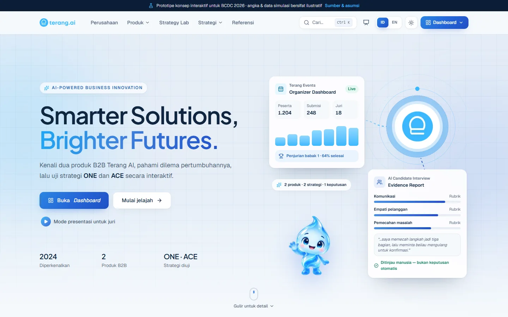</td>
    <td>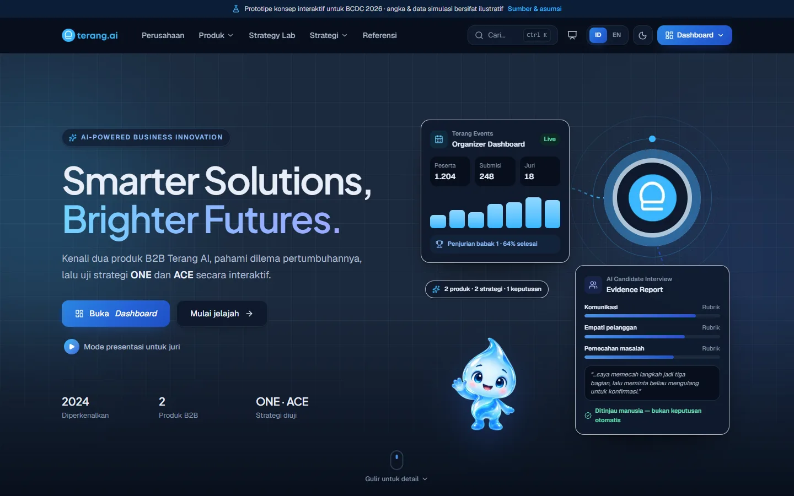</td>
  </tr>
  <tr>
    <td colspan="2" align="center"><sub><b>Landing page</b> — memperkenalkan dua produk B2B Terang AI, dilema pertumbuhan, serta pintu masuk ke strategi ONE / ACE dan <i>dashboard</i>.</sub></td>
  </tr>
</table>

<details open>
<summary><b>Halaman strategi</b></summary>
<br>

<table>
  <tr>
    <td width="50%">
      <picture>
        <source media="(prefers-color-scheme: dark)" srcset="assets/screenshots/id/one-strategy-dark.webp">
        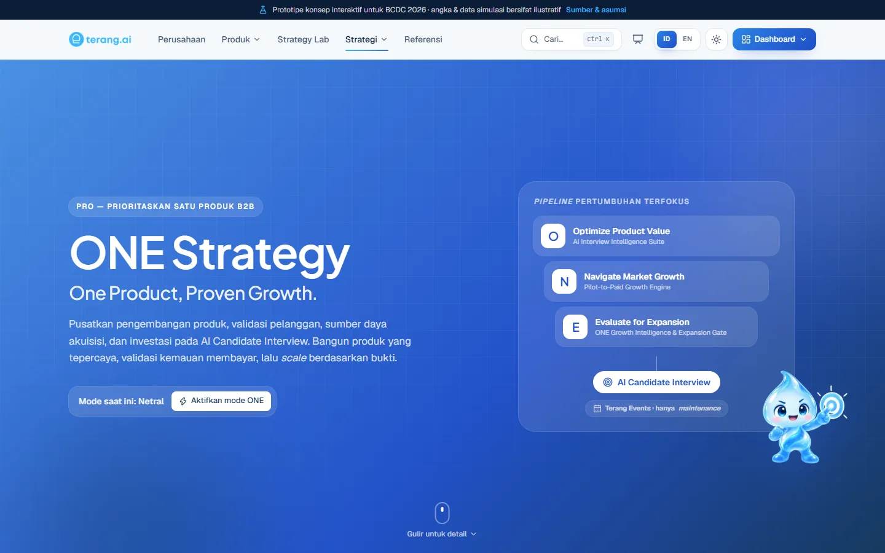
      </picture>
      <p align="center"><sub><b>ONE Strategy (PRO)</b> — <i>pipeline</i> pertumbuhan terfokus: Optimize → Navigate → Evaluate, dengan Terang Events dalam mode <i>maintenance</i>.</sub></p>
    </td>
    <td width="50%">
      <picture>
        <source media="(prefers-color-scheme: dark)" srcset="assets/screenshots/id/ace-strategy-dark.webp">
        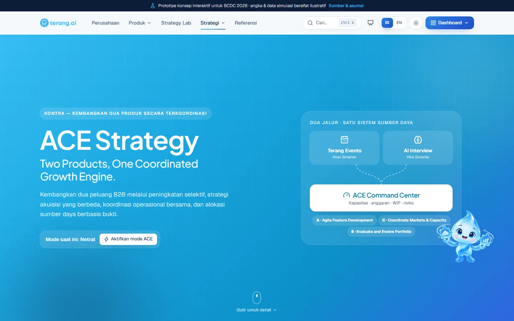
      </picture>
      <p align="center"><sub><b>ACE Strategy (KONTRA)</b> — dua jalur produk yang dikoordinasikan oleh satu sistem sumber daya.</sub></p>
    </td>
  </tr>
  <tr>
    <td>
      <picture>
        <source media="(prefers-color-scheme: dark)" srcset="assets/screenshots/id/strategy-lab-dark.webp">
        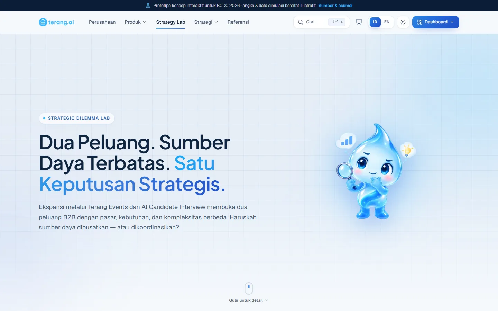
      </picture>
      <p align="center"><sub><b>Strategy Lab</b> — alur dilema interaktif, akar masalah, dan perbandingan produk.</sub></p>
    </td>
    <td>
      <picture>
        <source media="(prefers-color-scheme: dark)" srcset="assets/screenshots/id/presentation-dark.webp">
        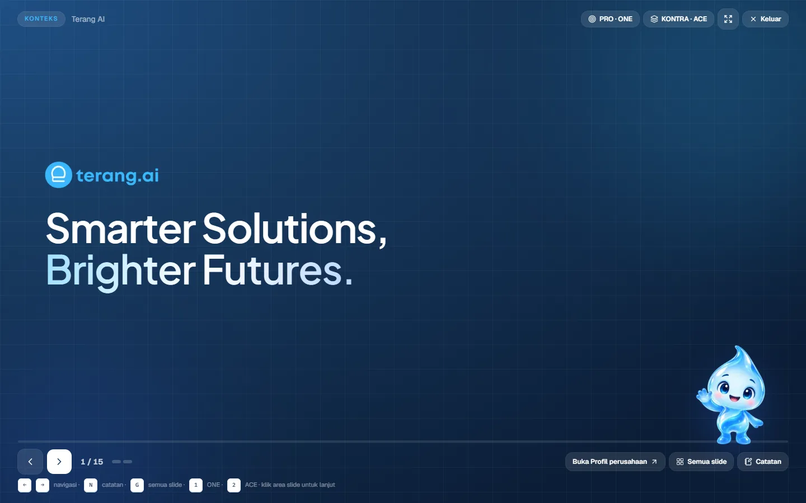
      </picture>
      <p align="center"><sub><b>Mode presentasi</b> — 15 <i>slide</i>, <i>reveal</i> bertahap, catatan pembicara, pintasan <i>keyboard</i>.</sub></p>
    </td>
  </tr>
</table>

</details>

<details open>
<summary><b>Dashboard produk & analitik</b></summary>
<br>

<table>
  <tr>
    <td width="50%">
      <picture>
        <source media="(prefers-color-scheme: dark)" srcset="assets/screenshots/id/interview-report-dark.webp">
        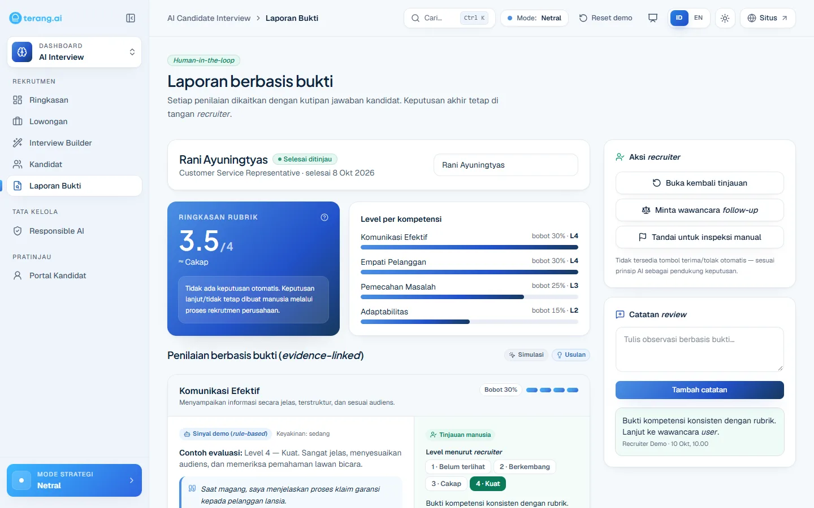
      </picture>
      <p align="center"><sub><b>Evidence-Linked Assessment</b> — setiap penilaian terhubung ke rubrik dan kutipan jawaban; tanpa terima/tolak otomatis.</sub></p>
    </td>
    <td width="50%">
      <picture>
        <source media="(prefers-color-scheme: dark)" srcset="assets/screenshots/id/interview-builder-dark.webp">
        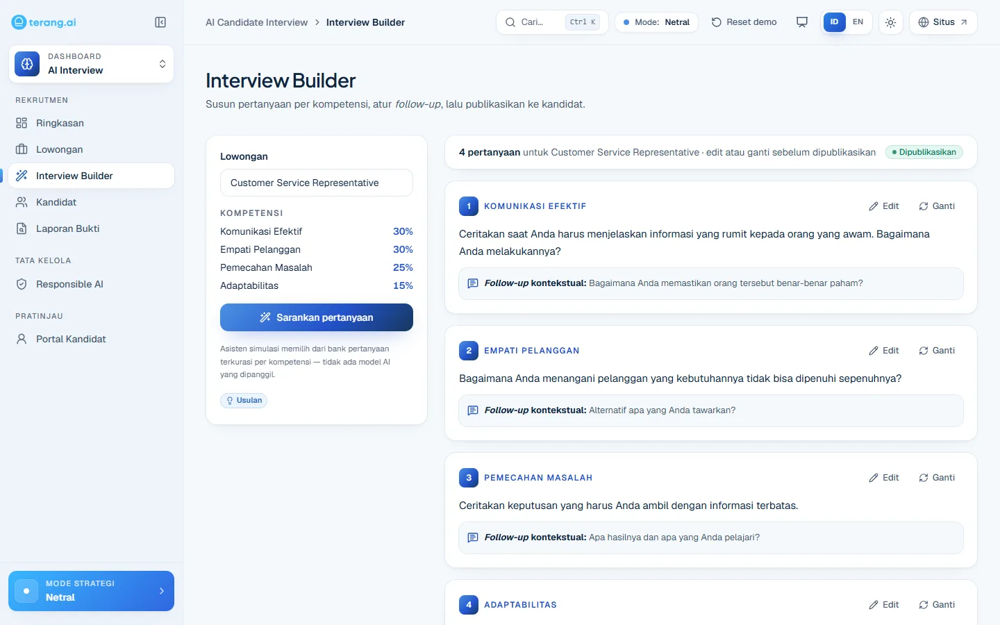
      </picture>
      <p align="center"><sub><b>Role-Based Interview Builder</b> — kompetensi berbobot, saran pertanyaan, dan <i>follow-up</i> kontekstual.</sub></p>
    </td>
  </tr>
  <tr>
    <td>
      <picture>
        <source media="(prefers-color-scheme: dark)" srcset="assets/screenshots/id/events-dashboard-dark.webp">
        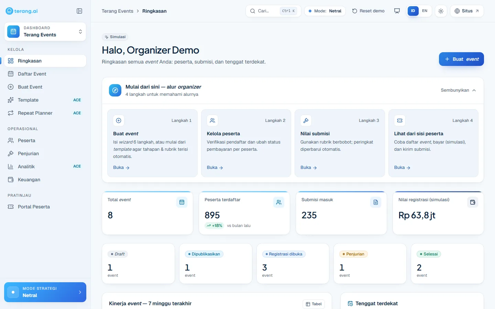
      </picture>
      <p align="center"><sub><b>Dashboard organizer Terang Events</b> — acara, peserta, submisi, dan tenggat.</sub></p>
    </td>
    <td>
      <picture>
        <source media="(prefers-color-scheme: dark)" srcset="assets/screenshots/id/events-templates-dark.webp">
        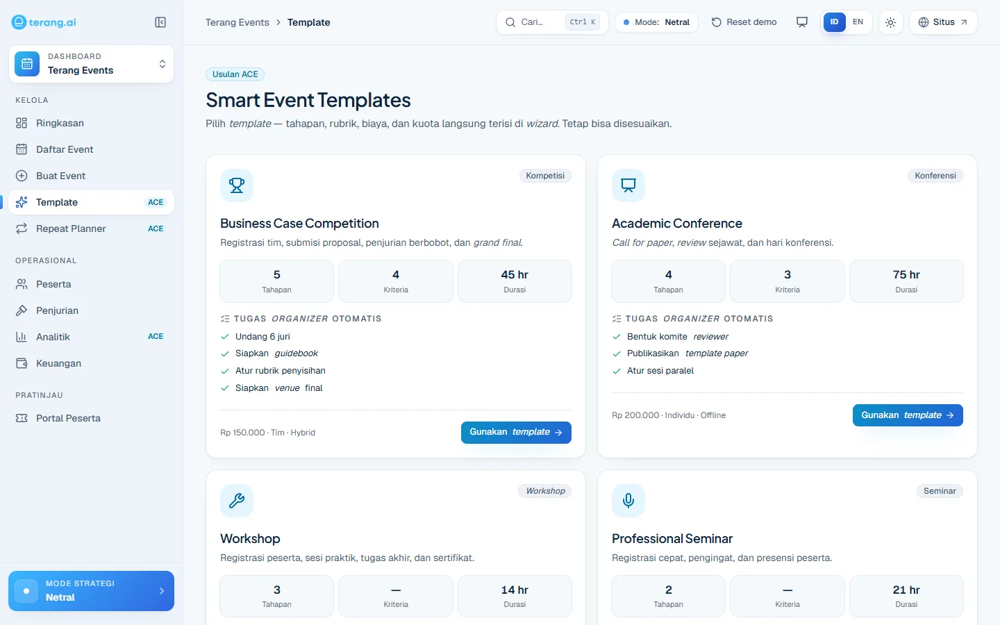
      </picture>
      <p align="center"><sub><b>Smart Event Templates</b> (ACE) — tahapan, rubrik, biaya, dan tugas terisi otomatis ke <i>wizard</i> acara.</sub></p>
    </td>
  </tr>
  <tr>
    <td>
      <picture>
        <source media="(prefers-color-scheme: dark)" srcset="assets/screenshots/id/simulator-dark.webp">
        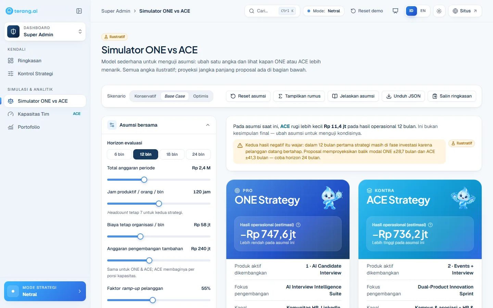
      </picture>
      <p align="center"><sub><b>Simulator ONE vs ACE</b> — preset skenario, asumsi yang dapat diubah, rumus, dan ekspor JSON.</sub></p>
    </td>
    <td>
      <picture>
        <source media="(prefers-color-scheme: dark)" srcset="assets/screenshots/id/portfolio-dark.webp">
        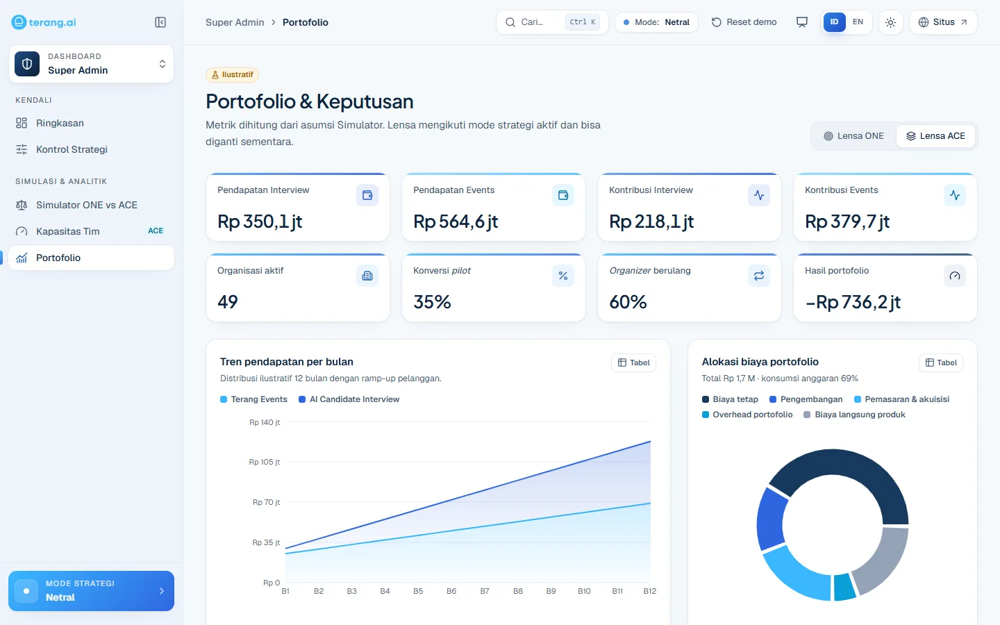
      </picture>
      <p align="center"><sub><b>Portofolio & Keputusan</b> — KPI per produk, tren pendapatan, dan alokasi biaya portofolio.</sub></p>
    </td>
  </tr>
  <tr>
    <td colspan="2">
      <picture>
        <source media="(prefers-color-scheme: dark)" srcset="assets/screenshots/id/operations-dark.webp">
        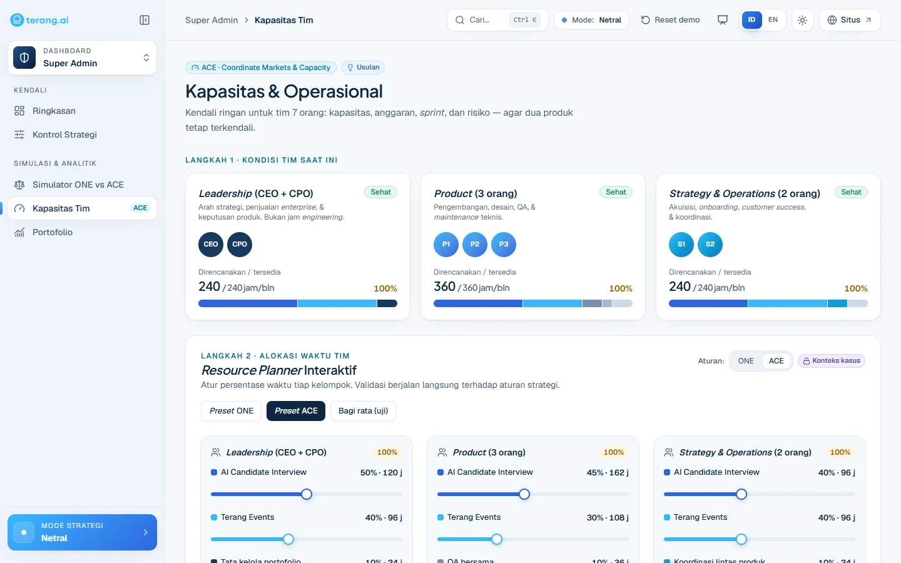
      </picture>
      <p align="center"><sub><b>Kapasitas & Operasional</b> (ACE Resource Control) — kapasitas 7 personel, alokasi waktu interaktif dengan aturan validasi ONE / ACE, anggaran, dan <i>sprint board</i>.</sub></p>
    </td>
  </tr>
</table>

<sub>Gambar otomatis menyesuaikan tema GitHub Anda. Screenshot berbahasa Inggris tersedia di <a href="assets/screenshots/en"><code>assets/screenshots/en</code></a>.</sub>

</details>

<br>

## Daftar Isi

1. [Gambaran Proyek](#-gambaran-proyek)
2. [Tantangan Bisnis & Akar Masalah](#-tantangan-bisnis--akar-masalah)
3. [Bukti Pasar — Insight Survei](#-bukti-pasar--insight-survei)
4. [Dua Pendekatan Strategis](#-dua-pendekatan-strategis)
5. [ONE Strategy — PRO](#-one-strategy--pro)
6. [ACE Strategy — KONTRA](#-ace-strategy--kontra)
7. [Etalase Fitur Produk](#-etalase-fitur-produk)
8. [Perbandingan Strategi & Roadmap Implementasi](#-perbandingan-strategi--roadmap-implementasi)
9. [KPI, Dampak Bisnis & Catatan Finansial](#-kpi-dampak-bisnis--catatan-finansial)
10. [Teknologi & Arsitektur](#-teknologi--arsitektur)
11. [Memulai](#-memulai)
12. [Struktur Proyek](#-struktur-proyek)
13. [Responsible AI & Privasi Data](#-responsible-ai--privasi-data)
14. [Referensi & Ucapan Terima Kasih](#-referensi--ucapan-terima-kasih)
15. [Kontributor](#-kontributor)
16. [Lisensi & Disclaimer](#-lisensi--disclaimer)

---

## ◆ Gambaran Proyek

**Terang AI** (PT Terang Inovasi Indonesia) adalah perusahaan teknologi berbasis AI asal Indonesia yang diperkenalkan pada 2024. Terang AI berawal dari layanan B2C untuk pembelajaran dan persiapan ujian (UTBK, CPNS, beasiswa seperti LPDP) serta simulasi wawancara AI melalui **Professor Terra**, lalu memperluas portofolionya ke solusi B2B untuk institusi.

Studi kasus ini berfokus pada dua peluang pertumbuhan B2B yang **sudah memiliki fondasi teknologi**:

<table>
  <tr>
    <th width="50%">🎯 AI Candidate Interview · <i>HRTech</i></th>
    <th width="50%">🗓️ Terang Events · <i>EventTech</i></th>
  </tr>
  <tr>
    <td>Wawancara kandidat terstruktur berbantuan AI yang membantu perusahaan menstandarkan <i>screening</i> dan menghasilkan penilaian berbasis bukti untuk ditinjau manusia.</td>
    <td>Platform acara & kompetisi yang mencakup registrasi, pembayaran, submisi, penjurian berbasis rubrik, peran <i>organizer</i> & <i>reviewer</i>, keuangan, dan analitik.</td>
  </tr>
  <tr>
    <td><b>Pembeli:</b> tim HR & <i>talent acquisition</i>, agensi rekrutmen</td>
    <td><b>Pembeli:</b> universitas, penyelenggara kompetisi, asosiasi, institusi</td>
  </tr>
  <tr>
    <td><b>Fondasi yang sudah ada:</b> simulasi wawancara Professor Terra (B2C), percakapan AI kontekstual, umpan balik wawancara</td>
    <td><b>Fondasi yang sudah ada:</b> platform publik dengan registrasi, pembayaran, submisi, rubrik penjurian, <i>tools</i> organizer</td>
  </tr>
  <tr>
    <td><b>Pola penggunaan:</b> berulang, mengikuti siklus rekrutmen</td>
    <td><b>Pola penggunaan:</b> episodik, mengikuti kalender akademik & acara</td>
  </tr>
</table>

Karena kedua produk sudah ada dalam bentuk tertentu, strategi yang diusulkan berfokus pada **peningkatan selektif, validasi komersial, dan ekspansi bisnis** — bukan membangun produk dari nol.

**Pertanyaan strategis utama**

> *Bagaimana Terang AI dapat mengoptimalkan prioritas pengembangan produk, alokasi sumber daya, dan penetrasi pasar untuk mencapai pertumbuhan B2B yang berkelanjutan?*

Proyek ini mengeksplorasi dua jawaban yang sengaja dibuat seimbang:

| | Strategi | Ringkasan satu kalimat |
|:--:|---|---|
| **PRO** | **ONE** — Focused Product Growth | Prioritaskan AI Candidate Interview, buktikan nilainya, lalu ekspansi. |
| **KONTRA** | **ACE** — Selective Portfolio Development | Kembangkan AI Candidate Interview dan Terang Events secara selektif dan bersamaan. |

Tidak ada strategi yang diposisikan selalu lebih unggul — masing-masing memiliki keunggulan, risiko eksekusi, dan implikasi finansial yang berbeda.

---

## ◆ Tantangan Bisnis & Akar Masalah

Studi kasus mengidentifikasi tiga celah strategis yang saling terkait. Ketiganya adalah kerangka analisis untuk pengambilan keputusan, **bukan bukti bahwa perusahaan sedang gagal**.

| # | Tantangan | Yang dipertimbangkan dalam analisis strategis |
|:--:|---|---|
| 01 | **Resource Capacity Gap** | Struktur dalam studi kasus terdiri dari **7 personel inti** (1 CEO, 1 CPO, 3 Product, 2 Strategy & Operations). Waktu *leadership* tidak bisa dihitung sebagai jam *engineering*, dan perekrutan besar-besaran bukan asumsi yang realistis. |
| 02 | **Product–Market Validation Gap** | Kedua produk memiliki pembeli, kriteria pembelian, kemauan membayar, dan siklus penjualan yang berbeda. Kesiapan *enterprise* produk wawancara tidak bisa diasumsikan dari simulator B2C. |
| 03 | **Portfolio Execution Complexity** | Dua *workflow*, dua kanal penjualan, dan dua model dukungan menimbulkan *context switching* dan beban koordinasi di tim kecil. |

Tantangan tersebut berlanjut ke beberapa dimensi keputusan yang dijawab oleh proposal:

- **Prioritas produk** — pengembangan paralel berisiko memecah fokus eksekusi.
- **Akuisisi pasar** — tim HR dan penyelenggara acara membeli dengan cara berbeda dan membutuhkan pendekatan *go-to-market* yang berbeda.
- **Keberlanjutan pendapatan** — langganan, biaya transaksi, dan biaya layanan memiliki *unit economics* yang berbeda.
- **Responsible AI & kepercayaan** — wawancara AI untuk perusahaan membutuhkan bukti, perlindungan privasi, transparansi, dan pengawasan manusia.

<sub>Struktur 7 personel adalah skenario dalam studi kasus, bukan verifikasi jumlah karyawan Terang AI saat ini.</sub>

---

## ◆ Bukti Pasar — Insight Survei

Untuk mendasarkan kedua strategi pada data, tim menjalankan survei independen melalui Google Form (**n = 113**, 24 Oktober 2026) yang sebagian besar menjangkau mahasiswa dan *fresh graduate*. Analisis lengkapnya ada di [`data-analysis/`](data-analysis) (notebook Jupyter + 30 grafik).

| Sinyal | Hasil | Mendukung |
|---|:--:|---|
| Pernah menyiapkan wawancara dalam 2 tahun terakhir | **91%** | ONE — kebutuhan berulang & mendesak |
| Butuh *feedback* & evaluasi jawaban, tetapi baru berlatih dengan AI | **73% → 13%** | ONE — *whitespace* AI besar (*feedback gap*) |
| Memilih "*feedback* objektif" vs "harga murah/gratis" sebagai pertimbangan utama | **30% vs 23%** | ONE — nilai lebih penting daripada harga |
| Pengelola acara yang masih memakai Google Forms / WhatsApp untuk registrasi | **80%** (dari 75) | ACE — pasar Events masih *underserved* |
| Punya pengalaman wawancara **dan** acara | **83%** | ACE — basis pengguna sama, peluang *cross-sell* |
| Menilai kedua produk sama relevan | **40%** | ACE — kelompok terbesar |
| Korelasi minat antara kedua produk | **ρ = 0,23** | ONE — dua pasar / GTM yang berbeda |

<details>
<summary><b>Lihat evidence board ONE vs ACE</b> (grafik survei)</summary>
<br>

</details>

> [!NOTE]
> Responden adalah **pengguna akhir** (kandidat dan panitia acara), bukan pembeli B2B. Survei ini menunjukkan kebutuhan dan minat — **bukan** ukuran kemauan membayar dari HR atau institusi. Preferensi Terang Events dibanding AI Interview (36 vs 28) **tidak signifikan secara statistik** (uji binomial p = 0,38).

---

## ◆ Dua Pendekatan Strategis

| |  **Focused Product Growth** |  **Selective Portfolio Development** |
|---|---|---|
| **Produk yang dikembangkan** | 1 — AI Candidate Interview | 2 — AI Candidate Interview + Terang Events |
| **Terang Events** | Dipertahankan (layanan tetap berjalan, tanpa pengembangan agresif) | Pengembangan selektif + akuisisi *organizer* |
| **Logika** | Validasi dan monetisasi lebih cepat | Komersialisasi yang terdiversifikasi |
| **Implementasi awal** | 12 bulan | 18 bulan |
| **Alokasi sumber daya** | ~80% untuk AI Interview, ~20% operasional bersama & *maintenance* | 3,15 / 2,65 / 1,20 FTE (Interview / Events / Bersama) |
| **Trade-off utama** | Terkonsentrasi pada satu pasar yang belum tervalidasi | Kapasitas terbagi, kompleksitas lebih tinggi, horizon finansial lebih panjang |

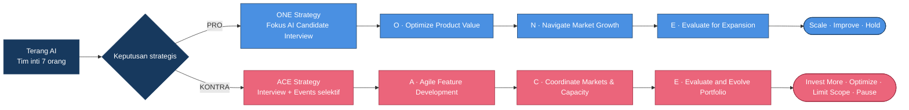

---

## ◆ ONE Strategy — PRO


ONE memprioritaskan **AI Candidate Interview** sebagai peluang pertumbuhan B2B utama Terang AI. Terang Events tetap berjalan dalam mode *maintenance*.

### O — Optimize Product Value

**Program: AI Interview Intelligence Suite** — mengubah teknologi wawancara konsumen yang sudah ada menjadi alat rekrutmen yang siap untuk *enterprise*.

| Fitur yang diusulkan | Fungsinya |
|---|---|
| **Role-Based Interview Builder** | HR mengatur pertanyaan dan rubrik penilaian per jabatan dan kompetensi yang dibutuhkan. |
| **Structured AI Interview** | Pertanyaan inti yang konsisten dan terstandar dengan *follow-up* kontekstual. |
| **Evidence-Linked Assessment Report** | Penilaian terhubung ke rubrik, transkrip, dan kutipan jawaban kandidat. |
| **Recruiter Review Dashboard** | Lowongan, undangan, progres, laporan, catatan, dan persetujuan manusia. |
| **Responsible AI & Privacy Controls** | Persetujuan, privasi, *explainability*, evaluasi keadilan, dan wajib tinjauan manusia. |

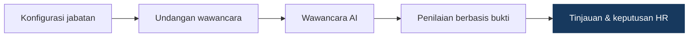

> Fitur-fitur ini adalah **usulan fitur enterprise**. Produk wawancara Terang AI yang tersedia untuk publik saat ini adalah simulasi untuk konsumen (Professor Terra). Rekomendasi AI tidak boleh menentukan hasil rekrutmen secara otomatis.

### N — Navigate Market Growth

**Program: Pilot-to-Paid Growth Engine**

- **Target pasar:** perusahaan dengan rekrutmen *entry-level* berulang — *customer service*, *sales*, operasional — serta penyedia jasa rekrutmen.
- **Kanal akuisisi:** *outreach* LinkedIn, webinar HR, komunitas HR, kemitraan B2B strategis, demo langsung, program *pilot*.

| Inisiatif | Tujuan |
|---|---|
| **HR Efficiency Clinic** | Sesi *discovery* terstruktur untuk menemukan hambatan dan inefisiensi proses rekrutmen. |
| **Terang Pilot Challenge** | *Pilot enterprise* dengan cakupan terbatas untuk mengukur kualitas, efisiensi, dan nilai bagi pelanggan. |
| **Verified Impact Stories** | Studi kasus berbasis persetujuan yang disusun dari hasil *pilot* yang terverifikasi. |

| Paket yang diusulkan | Harga / bulan |
|---|--:|
| Starter | Rp3,9 juta |
| Growth | Rp9,9 juta |
| Enterprise | Rp20,9 juta |

<sub>Paket harga adalah asumsi pemodelan untuk proposal ini, bukan harga resmi Terang AI.</sub>

### E — Evaluate for Expansion

**Program: ONE Growth Intelligence & Expansion Gate** — ekspansi hanya dilakukan ketika bukti menunjukkan produk dan model bisnis sudah siap.

Dimensi evaluasi: kualitas produk · efisiensi rekrutmen · konversi & retensi · kepatuhan Responsible AI · kinerja finansial · kapasitas operasional.

Kerangka keputusan: **Scale / Improve / Hold**. Kriteria privasi, keamanan, dan validitas penilaian berfungsi sebagai *hard gate* yang tidak dapat dikompensasi oleh kinerja komersial.

### Implementasi ONE — 12 bulan

| Fase | Bulan | Fokus |
|---|---|---|
| Q1 | M1–M3 | **Build & Validate** |
| Q2 | M4–M6 | **Pilot & Improve** |
| Q3 | M7–M9 | **Convert & Monetize** |
| Q4 | M10–M12 | **Evaluate & Scale** |

Sekitar **80%** kapasitas kerja dialokasikan untuk AI Candidate Interview dan **20%** untuk operasional bersama serta *maintenance* layanan lain. Perhitungan finansial di level perusahaan tetap memasukkan biaya penuh ketujuh personel.

---

## ◆ ACE Strategy — KONTRA


ACE mengembangkan **AI Candidate Interview dan Terang Events secara bersamaan** melalui investasi selektif, sumber daya bersama, dan evaluasi di level portofolio. ACE **tidak** mengasumsikan pembagian 50:50 — nilai tambah produk kedua harus sebanding dengan biaya tambahannya.

### A — Agile Feature Development

**Program: ACE Dual-Product Innovation Sprint**

| Terang Events (usulan) | AI Candidate Interview (usulan) |
|---|---|
| **Smart Event Templates** — konfigurasi siap pakai agar acara lebih cepat diluncurkan | **Role-Based Interview Builder** |
| **Repeat Event Planner** — memakai ulang konfigurasi acara sebelumnya tanpa menyalin data peserta | **Evidence-Based Assessment** |
| **Organizer Insight Dashboard** — *funnel* registrasi, partisipasi, konversi, kinerja acara | **HR Review Dashboard** |
| **AI Event Assistant** — bantuan konfigurasi, FAQ peserta, sebagian tugas administrasi (prioritas berikutnya) | **Responsible AI & privacy safeguards** |

**Prinsip operasional:** maksimal **dua inisiatif fitur besar** berjalan bersamaan di kedua produk, menyesuaikan kapasitas tim.

### C — Coordinate Markets & Capacity

**Program: Dual-Market Growth Engine**

| | Terang Events | AI Candidate Interview |
|---|---|---|
| **Target** | Universitas, organisasi mahasiswa, penyelenggara kompetisi, komunitas profesional, institusi dengan acara berulang | Departemen HR, tim rekrutmen, agensi rekrutmen |
| **Akuisisi** | Kemitraan *organizer*, *outreach* kampus, referensi acara, demo institusional, kemitraan acara berulang | *Outreach* LinkedIn, komunitas HR, webinar, *pilot-to-paid*, demo *enterprise* |
| **Pendapatan** | **Event Platform Fee** (paket + biaya transaksi) · **Managed Event Boost** (pengelolaan promosi opsional) · **Organizer Pro Subscription** | Paket yang sama dengan ONE agar perbandingan adil |

> Belanja iklan pihak ketiga **bukan** pendapatan Terang AI — yang dihitung hanya biaya layanan pengelolaan promosinya.

**ACE Resource Control Dashboard** memantau kapasitas tim, *backlog*, beban kerja, biaya per produk, *pipeline* penjualan, KPI, dan kontribusi finansial. Dalam praktiknya fungsi ini bisa dijalankan dengan *spreadsheet* atau *tool* manajemen proyek; repository ini menyertakan **prototipe**-nya (halaman *Kapasitas & Operasional*).

### E — Evaluate and Evolve Portfolio

**Program: ACE Portfolio Intelligence**

Yang dievaluasi: adopsi · pendapatan & *contribution margin* · retensi · kualitas produk · kapasitas *engineering* · kepuasan pelanggan · efisiensi operasional · keberlanjutan bisnis.

Keputusan portofolio: **Invest More / Optimize / Limit Scope / Pause Investment** — pilihan berdasarkan kinerja portofolio, bukan instruksi otomatis untuk meninggalkan suatu produk.

### Implementasi ACE — 18 bulan

| Fase | Bulan | Fokus |
|---|---|---|
| Q1 | M1–M3 | **Align & Build** |
| Q2 | M4–M6 | **Pilot & Activate** |
| Q3 | M7–M9 | **Acquire & Optimize** |
| Q4 | M10–M12 | **Expand Selectively** |
| Q5 | M13–M15 | **Improve Portfolio** |
| Q6 | M16–M18 | **Evaluate & Evolve** |

| Alokasi awal (7 orang) | FTE |
|---|--:|
| AI Candidate Interview | 3,15 |
| Terang Events | 2,65 |
| Operasional bersama | 1,20 |
| **Total** | **7,00** |

<sub>FTE menggambarkan pembagian waktu personel yang sudah ada — bukan karyawan paruh atau perekrutan tambahan.</sub>

---

## ◆ Etalase Fitur Produk

**Keterangan status**

| Label | Arti |
|---|---|
| `Existing Platform Capability` | Dijelaskan di halaman publik resmi Terang AI; belum tentu diimplementasikan di repository ini. |
| `Proposed Enhancement` | Bagian dari usulan ONE atau ACE. |
| `Prototyped` | Fitur usulan yang memiliki UI yang dapat dicoba di repository ini — berjalan dengan data fiktif dan aturan deterministik. |
| `Planned` | Tercatat sebagai prioritas berikutnya, belum dibangun. |

### AI Candidate Interview

| Fitur | Nilai bisnis | Status |
|---|---|---|
| Simulasi wawancara AI (Professor Terra) | Fondasi untuk wawancara terstruktur | `Existing Platform Capability` |
| Role-Based Interview Builder | *Screening* yang konsisten dan sesuai jabatan | `Proposed Enhancement` · `Prototyped` |
| Wawancara terstruktur dengan *follow-up* kontekstual | Jawaban antar-kandidat dapat dibandingkan | `Proposed Enhancement` · `Prototyped` |
| Laporan Evidence-Linked Assessment | Penilaian yang dapat diaudit dan dijelaskan untuk HR | `Proposed Enhancement` · `Prototyped` |
| Recruiter Review Dashboard (lowongan, kandidat, catatan) | Keputusan tetap di tangan manusia | `Proposed Enhancement` · `Prototyped` |
| Kontrol Responsible AI (peran, retensi, persetujuan) | Kepercayaan & kepatuhan *enterprise* | `Proposed Enhancement` · `Prototyped` |
| Portal kandidat | Pengalaman kandidat yang transparan | `Prototyped` |

### Terang Events

| Fitur | Nilai bisnis | Status |
|---|---|---|
| Registrasi, pembayaran, submisi, penjurian berbasis rubrik, peran *organizer* & *reviewer*, keuangan, analitik | Operasional inti acara | `Existing Platform Capability` · `Prototyped` (simulasi) |
| Smart Event Templates | *Setup* acara lebih cepat | `Proposed Enhancement` · `Prototyped` |
| Repeat Event Planner | Mempertahankan *organizer* berulang | `Proposed Enhancement` · `Prototyped` |
| Organizer Insight / Growth Analytics | Keputusan *organizer* berbasis data | `Proposed Enhancement` · `Prototyped` |
| Managed Event Boost · Organizer Pro Subscription | Aliran pendapatan baru | `Proposed Enhancement` |
| AI Event Assistant | Mengurangi pertanyaan administratif berulang | `Planned` |

### Tools strategi & portofolio (di repository ini)

| Fitur | Kegunaan | Status |
|---|---|---|
| Pengalih mode strategi (Overview / ONE / ACE) | Mengubah prioritas produk di seluruh situs | `Prototyped` |
| Roadmap, target KPI & proyeksi finansial (halaman ONE / ACE) | Membaca proposal per fase lengkap dengan target, pembagian FTE, dan proyeksi jangka panjang | `Prototyped` |
| Bukti pasar (Strategy Lab) | Hasil survei (n = 113) untuk kedua produk dan artinya bagi ONE vs ACE | `Prototyped` |
| Simulator finansial ONE vs ACE | Membandingkan strategi dengan asumsi yang sama, preset & sensitivitas, ekspor JSON | `Prototyped` |
| Kapasitas & Operasional (ACE Resource Control) | Merencanakan alokasi waktu 7 orang terhadap target FTE proposal, anggaran, *sprint board* dengan batas WIP, *timeline* 18 bulan | `Prototyped` |
| Portofolio & Decision Gate | KPI produk & portofolio dengan rekomendasi keputusan | `Prototyped` |
| Mode presentasi | 15 *slide*, catatan pembicara, navigasi *keyboard* | `Prototyped` |
| *Command palette* (Ctrl/⌘ + K), tema terang/gelap, bahasa ID/EN | Navigasi cepat dan aksesibilitas | `Prototyped` |

---

## ◆ Perbandingan Strategi & Roadmap Implementasi

| Dimensi | ONE — PRO | ACE — KONTRA |
|---|---|---|
| Fokus strategis | Kedalaman: menangkan satu pasar lebih dulu | Keluasan: bangun portofolio dua produk |
| Cakupan produk | AI Candidate Interview (Events dipertahankan) | AI Candidate Interview + Terang Events |
| Target pelanggan | Tim HR, agensi rekrutmen | Tim HR + penyelenggara acara & institusi |
| Monetisasi | Langganan Interview (Starter / Growth / Enterprise) | Langganan Interview + biaya platform acara, promosi terkelola, langganan *organizer* |
| Implementasi awal | 12 bulan | 18 bulan |
| Alokasi sumber daya | ~80% Interview / ~20% bersama | 3,15 / 2,65 / 1,20 FTE |
| Metrik keberhasilan utama | *Pilot*, kontrak, akun berbayar, penghematan waktu | Akun berbayar per produk, acara berbayar, *portfolio gate* |
| Risiko utama | Risiko konsentrasi; kepercayaan *enterprise*; siklus penjualan B2B | Fokus terbagi; beban koordinasi; *payback* lebih lama |
| Horizon proyeksi finansial | 36 bulan | 48 bulan |

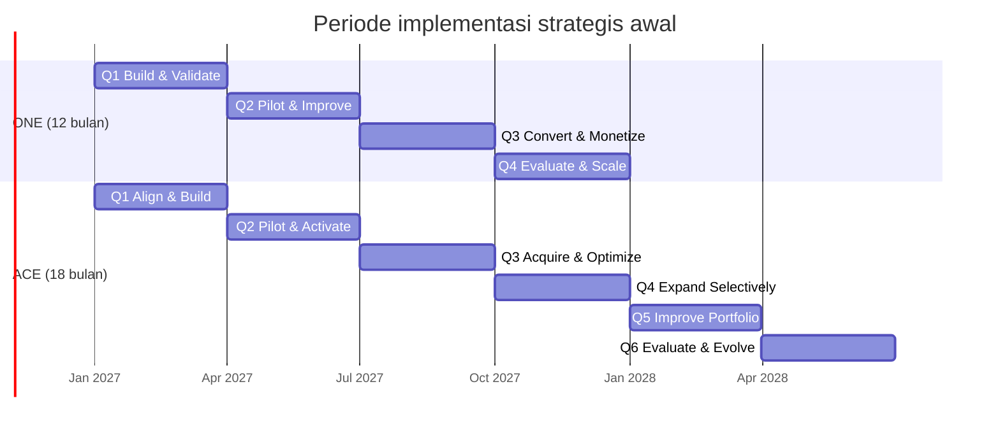

<sub>Tanggal mulai Januari 2027 hanya ilustrasi. 12 dan 18 bulan adalah <b>periode implementasi awal</b>, bukan seluruh siklus hidup bisnis — operasional, retensi, dan <i>scaling</i> tetap berlanjut setelahnya. Prototipe menampilkan kedua <i>roadmap</i> per fase di halaman strategi, plus <i>timeline</i> Gantt 18 bulan di ACE Command Center.</sub>

---

## ◆ KPI, Dampak Bisnis & Catatan Finansial

> [!WARNING]
> **Semua target dan hasil finansial adalah proyeksi strategis berdasarkan asumsi pemodelan, bukan kinerja perusahaan yang sudah terealisasi.**

### Target implementasi & komersial

| ONE — Tahun 1 (hingga M12) | Target |
|---|--:|
| *Lead* B2B berkualitas | 180 |
| Demo produk | 90 |
| *Pilot* selesai | 24 |
| Kontrak baru ditandatangani | 20 |
| Akun *enterprise* berbayar aktif | 18 |

| ACE — hingga M18 | Target |
|---|--:|
| Akun berbayar aktif AI Candidate Interview | 10 |
| *Organizer* acara berbayar aktif | 12 |
| Akumulasi acara berbayar | 30 |
| *Pilot* AI Interview selesai | 16 |
| Evaluasi portofolio / *decision gate* | Bulanan / kuartalan |

### Pengalaman pelanggan & efisiensi (ONE)

| Metrik | Target |
|---|--:|
| Penghematan waktu administrasi rekruter | ≥ 30% *(divalidasi saat pilot)* |
| Kepuasan rekruter | ≥ 4,2 / 5 |

### Proyeksi finansial jangka panjang

| Metrik proyeksi | ONE | ACE |
|---|--:|--:|
| Horizon proyeksi | 36 bulan | 48 bulan |
| Pendapatan | ≈ Rp8,45 M | ≈ Rp12,67 M |
| Total biaya operasional | ≈ Rp6,65 M | ≈ Rp10,47 M |
| Akumulasi surplus | ≈ Rp1,80 M *(operasional)* | ≈ Rp1,72 M *(setelah pajak)* |
| *Return on total costs* | ≈ 27,1% | ≈ 16,4% |
| NPV @ tingkat diskonto 15% per tahun | ≈ +Rp676,6 jt | ≈ +Rp235 jt |
| IRR efektif tahunan | ≈ 48% | ≈ 21,4% |
| *Payback* nominal | ≈ 28,7 bulan | ≈ 41,3 bulan |

<sub>M = miliar, jt = juta.</sub>

**Cara membaca angka ini**

- ***Return on total costs*** = akumulasi surplus ÷ total biaya operasional — bukan imbal hasil atas ekuitas pemegang saham.
- **NPV** bergantung pada asumsi tingkat diskonto 15% per tahun; tingkat yang berbeda akan mengubah hasilnya.
- ***Payback*** adalah bulan ketika akumulasi arus kas hasil model menjadi positif.
- ONE dan ACE memakai **horizon, cakupan, dan definisi surplus yang berbeda** (operasional vs setelah pajak), sehingga ROI, NPV, dan IRR keduanya bersifat indikatif, bukan perbandingan yang sepenuhnya setara.
- Hasil bergantung pada harga, akuisisi *enterprise*, retensi, volume acara berbayar, permintaan layanan promosi, dan efisiensi operasional. **Profitabilitas tidak dijamin.**

> [!NOTE]
> **Simulator ONE vs ACE** di dalam aplikasi adalah model pembelajaran 12 bulan yang terpisah dan disederhanakan (`website/src/data/scenarios.ts`, `website/src/lib/finance.ts`) dengan asumsi ilustratif yang dapat diubah. Pada *base case*, kedua strategi menunjukkan hasil operasional negatif dalam 12 bulan pertama — sejalan dengan *payback* multi-tahun di atas — sehingga keluarannya tidak boleh dibaca sebagai proyeksi proposal. Halaman simulator menjelaskan hal ini saat kedua hasil negatif dan menampilkan proyeksi jangka panjang proposal di bawahnya. Porsi kapasitas Interview pada ACE bawaannya 55%, langkah *slider* terdekat dengan pembagian 3,15 : 2,65 FTE di proposal.

---

## ◆ Teknologi & Arsitektur

### Tech stack (diverifikasi dari `website/package.json`)

| Lapisan | Teknologi | Kegunaan |
|---|---|---|
| Framework | **Next.js 16.4** (App Router, Turbopack, Cache Components) | *Routing*, *prerender* statis untuk 36 *route* |
| UI | **React 19.3**, **TypeScript 5** | Komponen dan model domain yang *type-safe* |
| Styling | **Tailwind CSS 4** dengan *design token* CSS | Tema brand, *token* terang/gelap |
| State | **Zustand 5** (+ `persist` → `localStorage`) | Mode strategi, data demo events, interview, operasional, skenario |
| Form & validasi | **React Hook Form 7**, **Zod 4** | *Wizard* pembuatan acara dan formulir registrasi peserta |
| Grafik | **Recharts 3** | Grafik KPI, *funnel*, pendapatan, dan alokasi |
| Animasi | **Motion 14**, **Lenis** | Animasi *reveal*, *smooth scrolling* (nonaktif saat `prefers-reduced-motion`) |
| Ikon & notifikasi | **lucide-react**, **sonner** | Ikon dan *toast* |
| Analisis data | **Python**, **Jupyter**, pandas, NumPy, SciPy, scikit-learn, matplotlib, seaborn, wordcloud | EDA survei, segmentasi PCA + K-means, uji chi-square / binomial / Spearman |

**Tidak ada backend, database, autentikasi, API AI eksternal, maupun penyedia pembayaran.** Belum ada *workflow* CI atau *test suite*; pemeriksaan kualitas yang tersedia adalah `npm run lint` (ESLint).

### Arsitektur

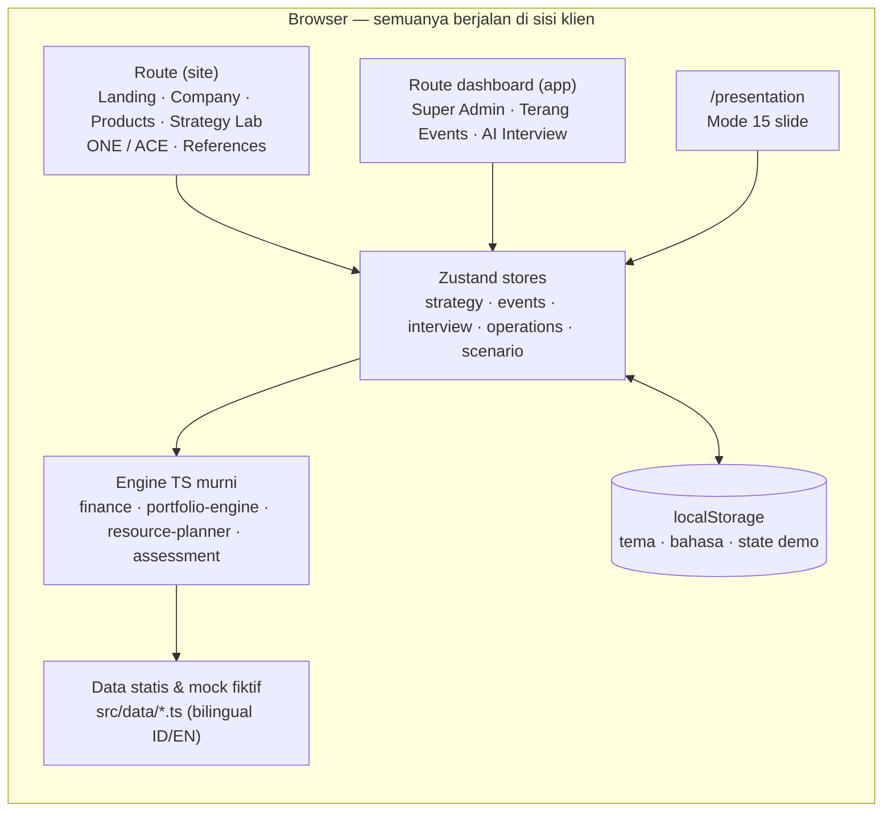

- **Konten bilingual** ditulis sebagai pasangan `{ id, en }` (`src/lib/i18n-core.ts`); bahasa aktif disimpan di `<html data-locale>` dan diterapkan sebelum *first paint*, sama seperti tema.
- **Logika penilaian** (`src/lib/assessment.ts`) adalah pencocokan sinyal teks berbasis aturan yang deterministik terhadap rubrik demo — secara eksplisit **bukan** *machine learning* dan **bukan** keputusan rekrutmen.
- **Label bukti** (`src/data/public-sources.ts`) menandai konten sebagai *sumber publik*, *konteks kasus*, *usulan*, *ilustratif*, atau *simulasi* di seluruh UI.

---

## ◆ Memulai

### Kebutuhan

- **Node.js** 20.9 atau lebih baru (dikembangkan dengan Node 24) dan **npm**
- *(Opsional, untuk notebook survei)* Python 3 dengan Jupyter dan *library* yang tercantum di atas

### Menjalankan website

```bash
git clone https://github.com/StyNW7/Terang-AI.git
cd Terang-AI/website

npm install
npm run dev          # http://localhost:3000
```

### Build produksi

```bash
npm run build
npm start            # menyajikan build teroptimasi di http://localhost:3000
```

### Lint

```bash
npm run lint
```

**Tidak perlu *environment variable*, API key, backend, atau database.** Semua data demo bersifat fiktif dan disimpan di `localStorage` browser; tombol **Reset demo** di setiap *dashboard* mengembalikan data awal.

### Pintasan berguna

| Pintasan | Aksi |
|---|---|
| `Ctrl/⌘ + K` | *Command palette* — buka halaman, ganti tema atau mode strategi |
| `[` | Buka / tutup *sidebar dashboard* |
| `←` / `→`, `N`, `G`, `1`, `2` | Presentasi: navigasi, catatan, semua *slide*, ONE, ACE |

### Menjelajahi analisis survei

```bash
cd data-analysis
jupyter notebook terang-ai-survey-analysis.ipynb
```

> [!CAUTION]
> Situs ini memakai `robots: noindex`, tetapi itu bukan kontrol akses. Jangan *deploy* secara publik tanpa pembatasan akses di level platform.

---

## ◆ Struktur Proyek

```text
Terang-AI/
├── README.md                     # Dokumentasi bahasa Inggris
├── README.id.md                  # Dokumentasi bahasa Indonesia (file ini)
├── Images/                       # Logo dan ilustrasi maskot Terang AI
├── assets/
│   └── screenshots/{en,id}/      # Screenshot asli prototipe (terang/gelap)
├── data-analysis/
│   ├── dataset.csv               # Respons survei (n = 113)
│   ├── terang-ai-survey-analysis.ipynb
│   ├── summary.md                # Insight utama untuk slide
│   └── figures/terang-ai/        # 30 grafik + headline_stats.csv
└── website/                      # Prototipe Next.js
    ├── public/{brand,mascot}/
    ├── next.config.ts            # Cache Components, redirect route lama
    └── src/
        ├── app/
        │   ├── (site)/           # Halaman publik storytelling
        │   ├── (app)/dashboard/  # Super Admin, events/*, interview/*
        │   └── presentation/     # Mode presentasi 15 slide
        ├── components/           # UI per domain (events, interview, strategy, portfolio, …)
        ├── data/                 # Perusahaan, strategi, skenario, tim, mock, sumber publik
        ├── lib/                  # finance, portfolio-engine, resource-planner, assessment, i18n, theme
        ├── store/                # Zustand store dengan persistensi localStorage berversi
        └── types/                # Tipe domain
```

### Peta route

| Route | Isi |
|---|---|
| `/` | Landing: hero, tentang, evolusi B2C→B2B, dua produk, dilema, pemilih ONE/ACE, *dashboard* |
| `/company` | Identitas, *timeline*, *positioning map*, sumber publik vs usulan |
| `/products`, `/products/events`, `/products/interview` | Ringkasan & detail produk |
| `/strategy-lab` | Alur dilema interaktif, akar masalah, perbandingan produk |
| `/strategies/one`, `/strategies/ace` | Tiga pilar per strategi (`?pillar=`) |
| `/presentation` | Presentasi 15 *slide* dengan catatan pembicara |
| `/references` | Sumber publik, label bukti, glosarium, rumus |
| `/dashboard` · `/strategy` · `/simulator` · `/operations` · `/portfolio` | *Workspace* Super Admin |
| `/dashboard/events/*` | Ringkasan, daftar, buat acara (*wizard* 6 langkah), template, *repeat planner*, peserta, penjurian, analitik, keuangan, portal peserta |
| `/dashboard/interview/*` | Ringkasan, lowongan, *builder*, kandidat, laporan bukti, Responsible AI, portal kandidat |

---

## ◆ Responsible AI & Privasi Data

AI Candidate Interview berdampak pada penghidupan seseorang, sehingga proposal ini menempatkan kepercayaan sebagai syarat produk, bukan pelengkap.

| Pengaman | Usulan | Di prototipe ini |
|---|---|---|
| **Keputusan *human-in-the-loop*** | AI mendukung, manusia memutuskan; tanpa penolakan otomatis | Tidak ada tombol terima/tolak; aksi rekruter berupa tinjau ulang, wawancara lanjutan, atau inspeksi manual |
| **Penilaian berbasis bukti** | Setiap penilaian terhubung ke rubrik + bukti jawaban | Kartu bukti dengan kutipan jawaban dan label tingkat keyakinan |
| **Transparansi & *explainability*** | Kandidat tahu bagaimana mereka dinilai | Sinyal berbasis aturan ditampilkan terbuka; berlabel *sinyal demo* |
| **Persetujuan & perlindungan data** | Persetujuan eksplisit, pemberitahuan privasi, hak menarik persetujuan | Peran kandidat dapat melihat jawaban sendiri & menarik persetujuan (simulasi) |
| **Kontrol akses** | Izin berbasis peran | Matriks izin untuk HR Admin, Recruiter, Hiring Manager, Candidate |
| **Retensi & penghapusan data** | Periode retensi dan kebijakan penghapusan yang jelas | Pengaturan retensi (30 / 90 / 180 hari) — simulasi |
| **Evaluasi keadilan & bias** | Tinjauan *adverse impact* berkala antarkelompok | `Proposed` — langkah tata kelola, belum diimplementasikan |
| **Pemantauan kualitas & *audit trail*** | Tinjauan manusia atas sampel, log audit | *Audit trail* masih `Proposed` (ada di *sprint backlog*) |

> Skor yang dihasilkan AI **tidak boleh** menjadi satu-satunya penentu diterima atau tidaknya seseorang. Kesiapan Responsible AI adalah ***hard gate*** dalam Expansion Gate ONE.

Prototipe ini hanya menyimpan **data demo fiktif** di `localStorage` dan tidak pernah mengumpulkan informasi pribadi nyata.

---

## ◆ Referensi & Ucapan Terima Kasih

**Sumber publik resmi (Terang AI)**

- [Terang AI — situs resmi](https://terang.ai/)
- [Wawancara AI (Professor Terra)](https://terang.ai/wawancara-ai)
- [Terang Events](https://events.terang.ai/) · [Terang Events untuk Organizer](https://events.terang.ai/organizers)
- [Blog Terang AI](https://blog.terang.ai/) · [Pengumuman peluncuran](https://blog.terang.ai/blog/terang-ai-launch-announcement/) · [Terang AI di INTI 2026](https://blog.terang.ai/blog/terang-ai-inti-2026/)

**Dokumentasi teknologi**

- [Next.js](https://nextjs.org/docs) · [React](https://react.dev/) · [Tailwind CSS](https://tailwindcss.com/docs) · [Zustand](https://zustand.docs.pmnd.rs/) · [Recharts](https://recharts.org/) · [Motion](https://motion.dev/) · [Zod](https://zod.dev/)

**Data**

- Survei independen tim melalui Google Form, n = 113 responden, 24 Oktober 2026 — lihat [`data-analysis/summary.md`](data-analysis/summary.md).

Nama merek, logo, dan maskot Terang AI adalah milik pemiliknya masing-masing dan digunakan di sini hanya untuk keperluan studi kasus akademik.

---

## ◆ Kontributor

| Kontributor | Peran |
|---|---|
| [**Stanley Nathanael Wijaya**](https://github.com/StyNW7) | Penulis repository |

---

## ◆ Lisensi & Disclaimer

**Lisensi:** repository ini belum menyertakan file lisensi, sehingga secara bawaan seluruh hak dilindungi oleh penulis. Hubungi penulis sebelum menggunakan ulang kode atau kontennya.

**Disclaimer:** ini adalah **studi kasus akademik dan usulan strategis yang dikembangkan secara independen** untuk BCDC 2026. Ini bukan produk, website, daftar harga, atau pengumuman resmi Terang AI, dan tidak menyiratkan afiliasi dengan PT Terang Inovasi Indonesia. Fakta perusahaan hanya berasal dari halaman publik Terang AI; tim 7 orang, seluruh target, harga, dan angka finansial adalah skenario studi kasus atau asumsi pemodelan.

<div align="center">
<br>

<br>
<sub><b>ONE</b> fokus untuk membuktikan nilai. <b>ACE</b> berkoordinasi untuk diversifikasi. Keduanya diuji secara adil.</sub>
</div>
