<div align="center">

<a href="#">
  
</a>

# Terang AI — Strategic Product Innovation

**Two Strategic Perspectives. One Vision for Sustainable Growth.**

*Reimagining AI-powered recruitment and event management through the ONE & ACE Strategies.*

<p>
  <strong>English</strong> · <a href="README.id.md">Bahasa Indonesia</a>
</p>

<p>
  
  
  
  
  
  
</p>

<p>
  
  
  
  
  
  
  
</p>

<p>
  <a href="#-live-website--visual-preview"><strong>Preview</strong></a> ·
  <a href="#-the-two-strategic-approaches"><strong>ONE vs ACE</strong></a> ·
  <a href="#-product-feature-showcase"><strong>Features</strong></a> ·
  <a href="#-kpis-business-impact--financial-notes"><strong>KPIs & Financials</strong></a> ·
  <a href="#-getting-started"><strong>Run Locally</strong></a>
</p>

<p>
  Official references:
  <a href="https://terang.ai/">terang.ai</a> ·
  <a href="https://terang.ai/wawancara-ai">AI Interview</a> ·
  <a href="https://events.terang.ai/">Terang Events</a> ·
  <a href="https://events.terang.ai/organizers">Events for Organizers</a>
</p>

</div>

---

Terang AI has built two promising B2B foundations — an AI interview technology and an event & competition platform — but a seven-person core team cannot push both at full speed. This repository presents an interactive web prototype, a 113-respondent market survey and two competing growth strategies, **ONE (PRO)** and **ACE (CONTRA)**, that answer one question: *focus on one product, or grow both selectively?*

> [!IMPORTANT]
> **Independent academic case study — not an official Terang AI product.**
> This project was developed independently for the **BCDC 2026** business case competition. It is not affiliated with, endorsed by, or an announcement from PT Terang Inovasi Indonesia. All strategies, prices, targets and financial results below are **proposals and projections based on modelling assumptions**, not company commitments or realised performance. The prototype runs on **fictional data and deterministic rules** — no real AI model, payments, or personal data are involved.

<br>

## ✦ Live Website & Visual Preview

The prototype is a fully navigable Next.js website with a public storytelling site, three working dashboards (Super Admin, Terang Events, AI Candidate Interview), a financial simulator and a 15-slide presentation mode. Every page supports **Light & Dark Mode** and **Indonesian / English** content. All screenshots below were captured from the actual running application.

<table>
  <tr>
    <th width="50%">Light Mode</th>
    <th width="50%">Dark Mode</th>
  </tr>
  <tr>
    <td>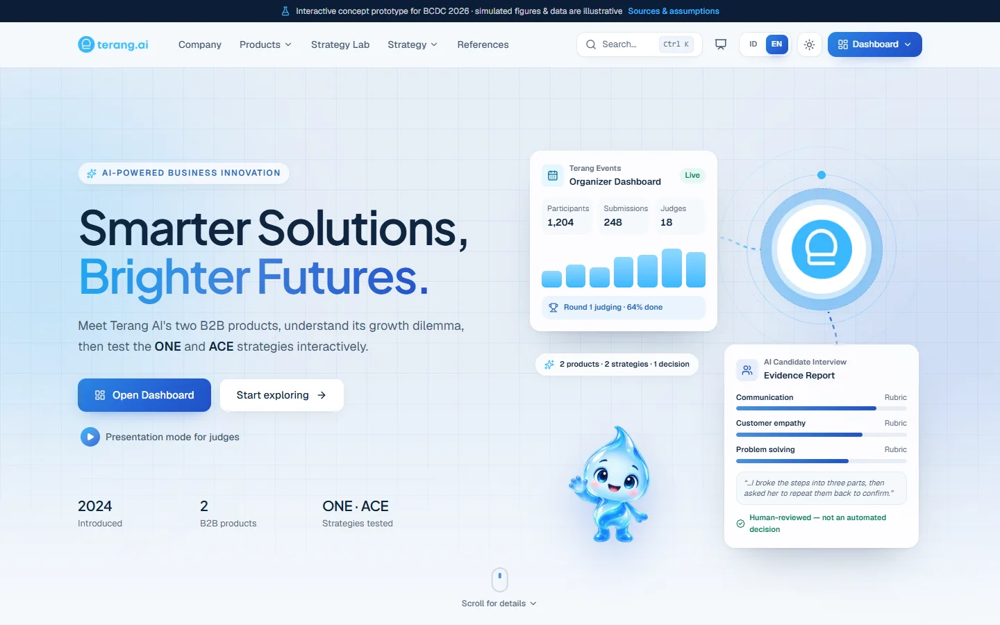</td>
    <td>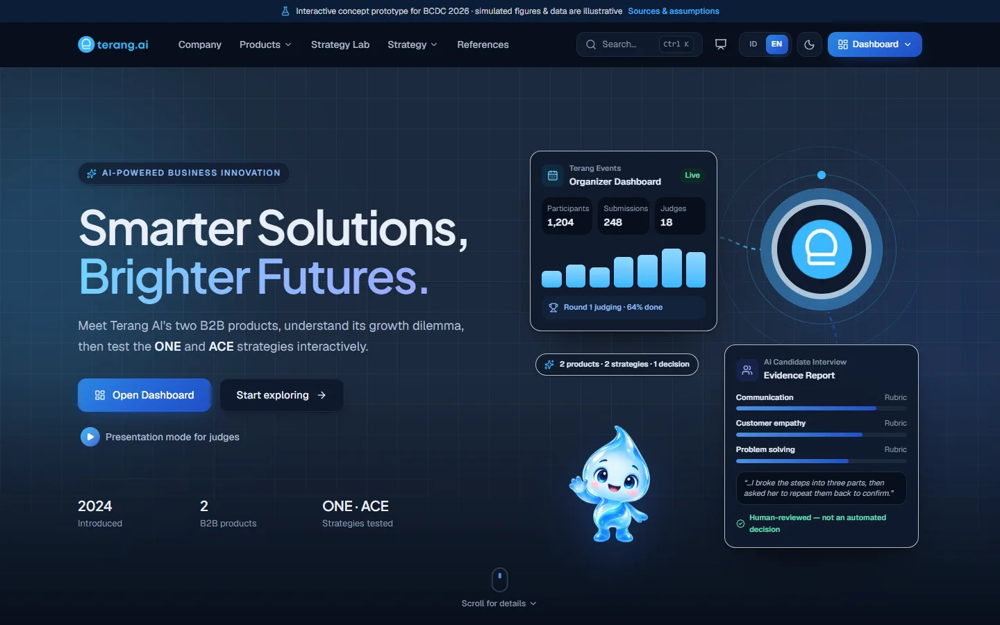</td>
  </tr>
  <tr>
    <td colspan="2" align="center"><sub><b>Landing page</b> — introduces Terang AI's two B2B products, the growth dilemma, and entry points to the ONE / ACE strategies and dashboards.</sub></td>
  </tr>
</table>

<details open>
<summary><b>Strategy pages</b></summary>
<br>

<table>
  <tr>
    <td width="50%">
      <picture>
        <source media="(prefers-color-scheme: dark)" srcset="assets/screenshots/en/one-strategy-dark.webp">
        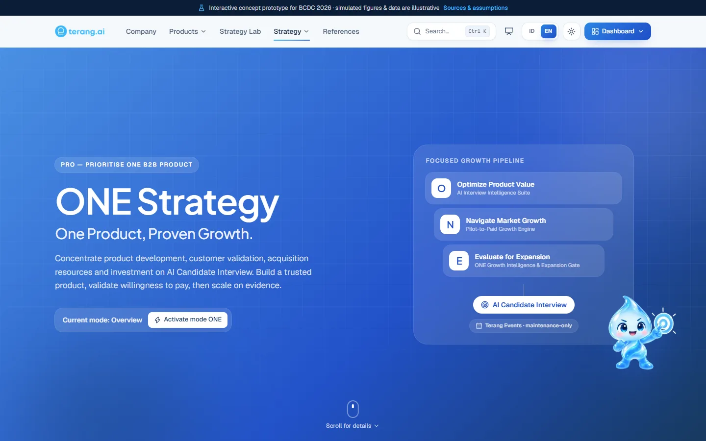
      </picture>
      <p align="center"><sub><b>ONE Strategy (PRO)</b> — focused growth pipeline: Optimize → Navigate → Evaluate, with Terang Events in maintenance mode.</sub></p>
    </td>
    <td width="50%">
      <picture>
        <source media="(prefers-color-scheme: dark)" srcset="assets/screenshots/en/ace-strategy-dark.webp">
        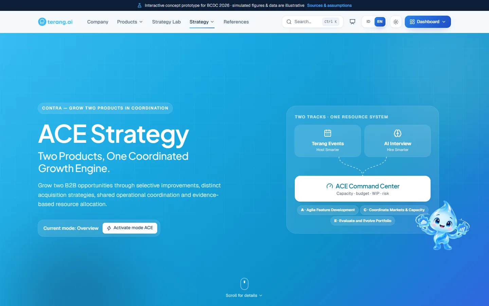
      </picture>
      <p align="center"><sub><b>ACE Strategy (CONTRA)</b> — two product tracks coordinated through one resource system.</sub></p>
    </td>
  </tr>
  <tr>
    <td>
      <picture>
        <source media="(prefers-color-scheme: dark)" srcset="assets/screenshots/en/strategy-lab-dark.webp">
        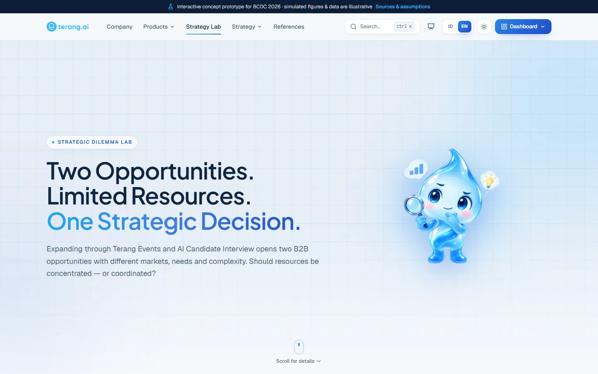
      </picture>
      <p align="center"><sub><b>Strategy Lab</b> — interactive dilemma flow, root causes and product comparison.</sub></p>
    </td>
    <td>
      <picture>
        <source media="(prefers-color-scheme: dark)" srcset="assets/screenshots/en/presentation-dark.webp">
        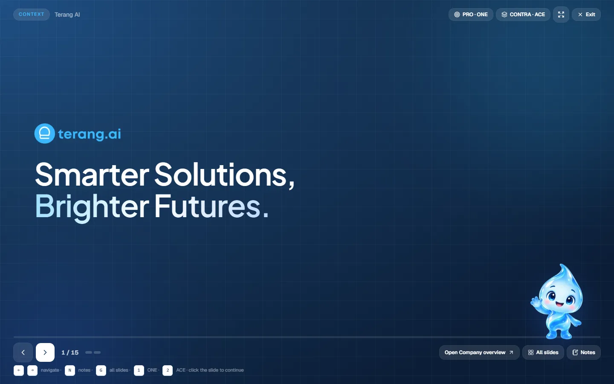
      </picture>
      <p align="center"><sub><b>Presentation mode</b> — 15 slides, staged reveals, speaker notes, keyboard shortcuts.</sub></p>
    </td>
  </tr>
</table>

</details>

<details open>
<summary><b>Product dashboards & analytics</b></summary>
<br>

<table>
  <tr>
    <td width="50%">
      <picture>
        <source media="(prefers-color-scheme: dark)" srcset="assets/screenshots/en/interview-report-dark.webp">
        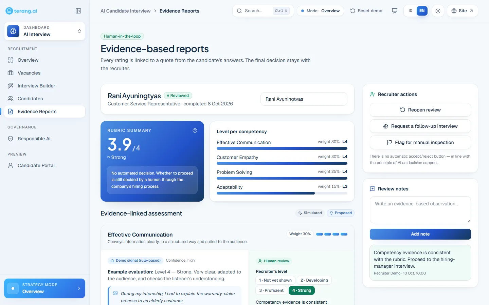
      </picture>
      <p align="center"><sub><b>Evidence-Linked Assessment</b> — every rating tied to rubric and answer quotes; no automatic accept/reject.</sub></p>
    </td>
    <td width="50%">
      <picture>
        <source media="(prefers-color-scheme: dark)" srcset="assets/screenshots/en/interview-builder-dark.webp">
        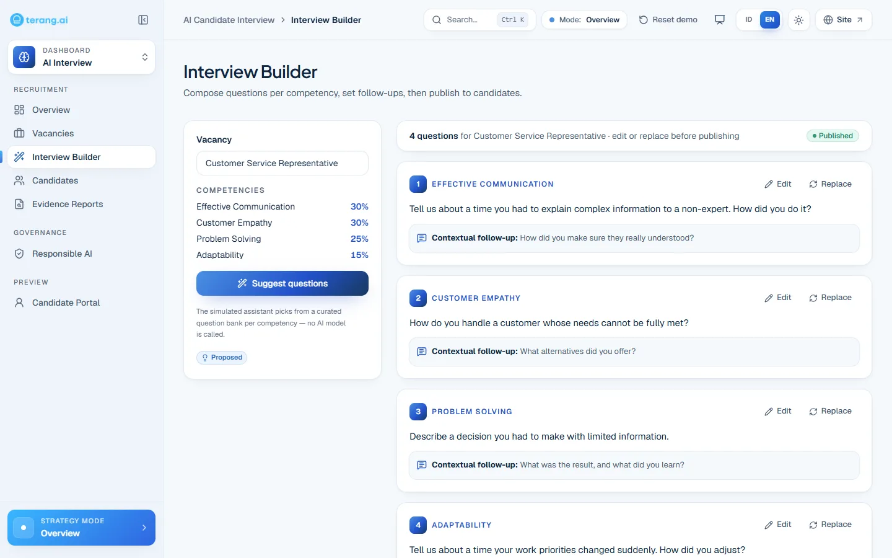
      </picture>
      <p align="center"><sub><b>Role-Based Interview Builder</b> — weighted competencies, suggested questions and contextual follow-ups.</sub></p>
    </td>
  </tr>
  <tr>
    <td>
      <picture>
        <source media="(prefers-color-scheme: dark)" srcset="assets/screenshots/en/events-dashboard-dark.webp">
        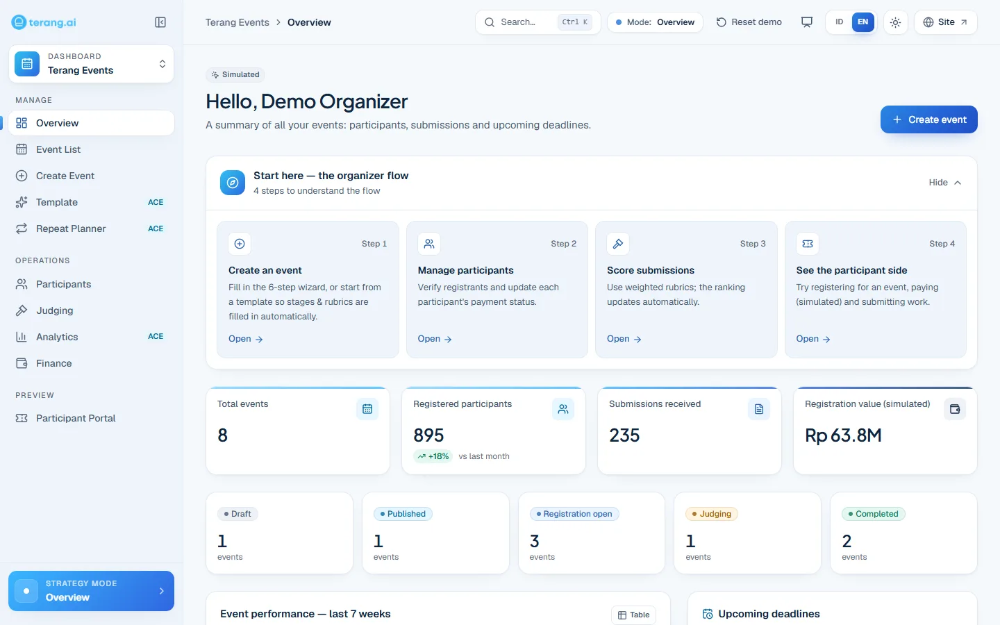
      </picture>
      <p align="center"><sub><b>Terang Events organizer dashboard</b> — events, participants, submissions and deadlines.</sub></p>
    </td>
    <td>
      <picture>
        <source media="(prefers-color-scheme: dark)" srcset="assets/screenshots/en/events-templates-dark.webp">
        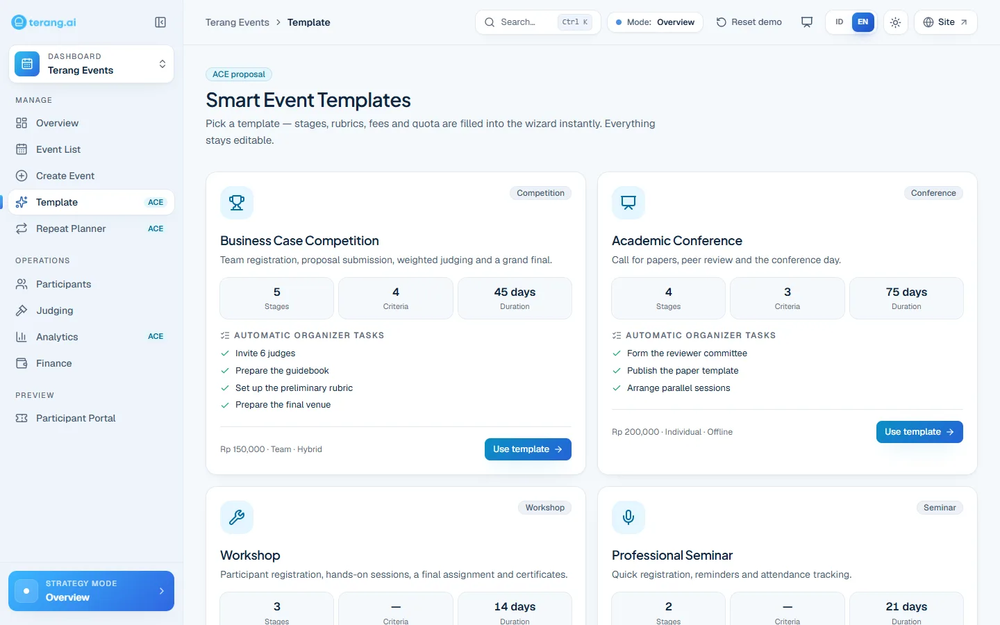
      </picture>
      <p align="center"><sub><b>Smart Event Templates</b> (ACE) — stages, rubrics, fees and tasks pre-filled into the event wizard.</sub></p>
    </td>
  </tr>
  <tr>
    <td>
      <picture>
        <source media="(prefers-color-scheme: dark)" srcset="assets/screenshots/en/simulator-dark.webp">
        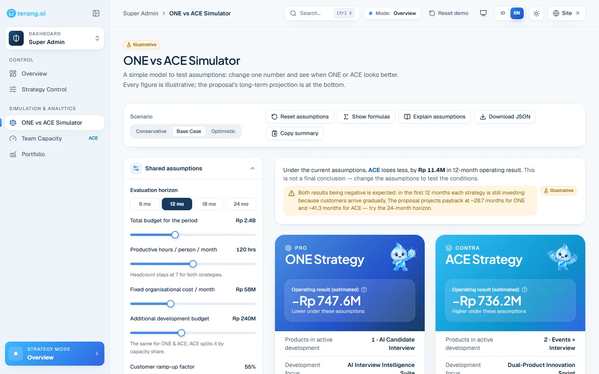
      </picture>
      <p align="center"><sub><b>ONE vs ACE Simulator</b> — scenario presets, editable assumptions, formulas and JSON export.</sub></p>
    </td>
    <td>
      <picture>
        <source media="(prefers-color-scheme: dark)" srcset="assets/screenshots/en/portfolio-dark.webp">
        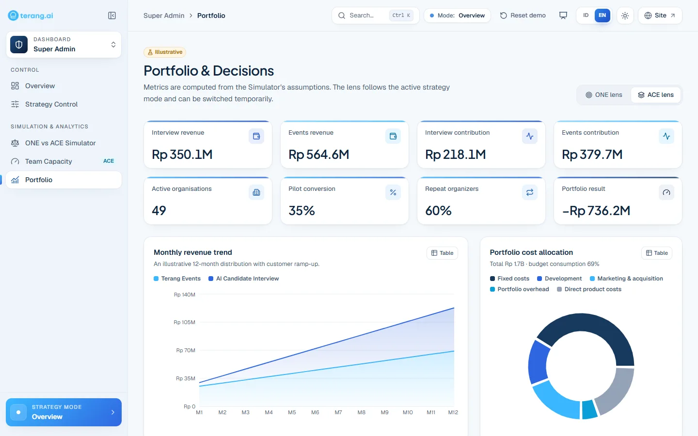
      </picture>
      <p align="center"><sub><b>Portfolio & Decisions</b> — product-level KPIs, revenue trend and portfolio cost allocation.</sub></p>
    </td>
  </tr>
  <tr>
    <td colspan="2">
      <picture>
        <source media="(prefers-color-scheme: dark)" srcset="assets/screenshots/en/operations-dark.webp">
        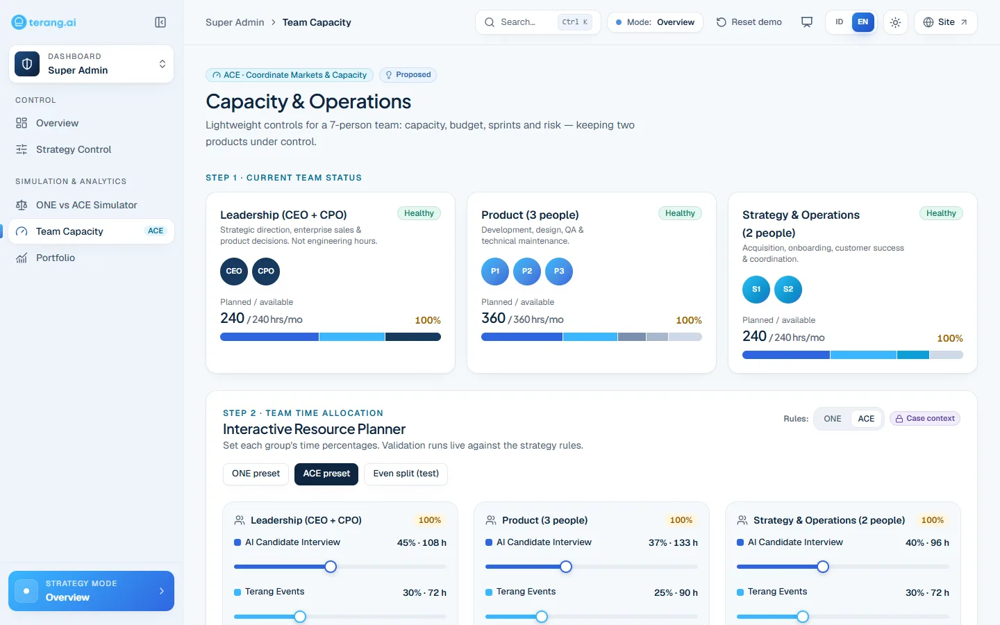
      </picture>
      <p align="center"><sub><b>Capacity & Operations</b> (ACE Resource Control) — 7-person capacity, interactive time allocation with ONE / ACE validation rules, budget and sprint board.</sub></p>
    </td>
  </tr>
</table>

<sub>Images switch automatically with your GitHub theme. Indonesian-language screenshots are in <a href="assets/screenshots/id"><code>assets/screenshots/id</code></a>.</sub>

</details>

<br>

## Table of Contents

1. [Project Overview](#-project-overview)
2. [Business Challenge & Root Cause](#-business-challenge--root-cause)
3. [Market Evidence — Survey Insights](#-market-evidence--survey-insights)
4. [The Two Strategic Approaches](#-the-two-strategic-approaches)
5. [ONE Strategy — PRO](#-one-strategy--pro)
6. [ACE Strategy — CONTRA](#-ace-strategy--contra)
7. [Product Feature Showcase](#-product-feature-showcase)
8. [Strategy Comparison & Implementation Roadmap](#-strategy-comparison--implementation-roadmap)
9. [KPIs, Business Impact & Financial Notes](#-kpis-business-impact--financial-notes)
10. [Technology & Architecture](#-technology--architecture)
11. [Getting Started](#-getting-started)
12. [Project Structure](#-project-structure)
13. [Responsible AI & Data Privacy](#-responsible-ai--data-privacy)
14. [References & Acknowledgements](#-references--acknowledgements)
15. [Contributors](#-contributors)
16. [License & Disclaimer](#-license--disclaimer)

---

## ◆ Project Overview

**Terang AI** (PT Terang Inovasi Indonesia) is an Indonesian AI-powered technology company introduced in 2024. It started with B2C learning and exam preparation (UTBK, CPNS, scholarships such as LPDP) and AI interview simulation through **Professor Terra**, and has since expanded toward B2B solutions for institutions.

This case study focuses on two B2B growth opportunities that **already have technology foundations**:

<table>
  <tr>
    <th width="50%">🎯 AI Candidate Interview · <i>HRTech</i></th>
    <th width="50%">🗓️ Terang Events · <i>EventTech</i></th>
  </tr>
  <tr>
    <td>AI-assisted, structured candidate interviews that help companies standardise screening and produce evidence-based assessments that humans review.</td>
    <td>An event & competition platform covering registration, payments, submissions, rubric-based judging, organizer & reviewer roles, finance and analytics.</td>
  </tr>
  <tr>
    <td><b>Buyer:</b> HR & talent-acquisition teams, recruitment agencies</td>
    <td><b>Buyer:</b> universities, competition organizers, associations, institutions</td>
  </tr>
  <tr>
    <td><b>Existing foundation:</b> Professor Terra interview simulation (B2C), contextual AI conversations, interview feedback</td>
    <td><b>Existing foundation:</b> public platform with registration, payments, submissions, judging rubrics, organizer tools</td>
  </tr>
  <tr>
    <td><b>Usage pattern:</b> recurring, follows hiring cycles</td>
    <td><b>Usage pattern:</b> episodic, follows the academic & event calendar</td>
  </tr>
</table>

Because both products exist in some form, the proposed strategies are about **selective improvement, commercial validation and business expansion** — not building either product from scratch.

**Key strategic question**

> *How can Terang AI optimise its product-development priorities, resource allocation and market penetration to achieve sustainable B2B growth?*

The project explores two deliberately balanced answers:

| | Strategy | One-line summary |
|:--:|---|---|
| **PRO** | **ONE** — Focused Product Growth | Prioritise AI Candidate Interview, prove value, then expand. |
| **CONTRA** | **ACE** — Selective Portfolio Development | Develop AI Candidate Interview and Terang Events selectively and concurrently. |

Neither strategy is presented as universally superior — each has distinct advantages, execution risks and financial implications.

---

## ◆ Business Challenge & Root Cause

The case study identifies three connected strategic gaps. They are an analytical framework for the decision, **not evidence that the company is failing**.

| # | Challenge | What the strategic analysis considers |
|:--:|---|---|
| 01 | **Resource Capacity Gap** | The case's structure has **7 core personnel** (1 CEO, 1 CPO, 3 Product, 2 Strategy & Operations). Leadership time cannot be treated as engineering hours, and large-scale hiring is not a realistic assumption. |
| 02 | **Product–Market Validation Gap** | The two products have different buyers, purchase criteria, willingness to pay and sales cycles. Enterprise readiness of the interview product cannot be assumed from the B2C simulator. |
| 03 | **Portfolio Execution Complexity** | Two workflows, two sales channels and two support models create context switching and coordination overhead in a small team. |

These challenges cascade into further decision dimensions the proposal addresses:

- **Product prioritisation** — concurrent development may dilute execution focus.
- **Market acquisition** — HR teams and event organizers buy differently and need different go-to-market motions.
- **Revenue sustainability** — subscriptions, transaction fees and service fees have different unit economics.
- **Responsible AI & trust** — AI interviews for enterprises need evidence, privacy protection, transparency and human oversight.

<sub>The 7-person structure is the scenario given in the case study, not a verified statement about Terang AI's current headcount.</sub>

---

## ◆ Market Evidence — Survey Insights

To ground both strategies in data, the team ran an independent Google Form survey (**n = 113**, 24 October 2026), mostly reaching university students and fresh graduates. The full analysis lives in [`data-analysis/`](data-analysis) (Jupyter notebook + 30 figures).

| Signal | Result | Reads as support for |
|---|:--:|---|
| Prepared for an interview in the last 2 years | **91%** | ONE — recurring, urgent need |
| Need answer feedback & evaluation, yet already practise with AI | **73% → 13%** | ONE — large AI whitespace (*feedback gap*) |
| Chose "objective feedback" vs "cheap / free" as main consideration | **30% vs 23%** | ONE — value matters more than price |
| Event organizers still running registration on Google Forms / WhatsApp | **80%** (of 75) | ACE — underserved events market |
| Have both interview **and** event experience | **83%** | ACE — shared user base, cross-sell |
| Rate both products equally relevant | **40%** | ACE — largest single group |
| Interest correlation between the two products | **ρ = 0.23** | ONE — two distinct markets / GTMs |

<details>
<summary><b>View the ONE vs ACE evidence board</b> (survey figure, Indonesian labels)</summary>
<br>
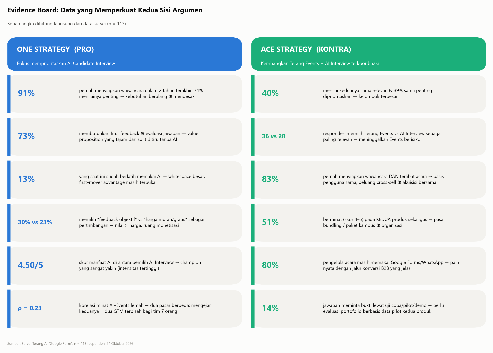
</details>

> [!NOTE]
> Respondents are **end users** (candidates and event committees), not B2B buyers. The survey indicates need and interest — it is **not** a measure of HR or institutional willingness to pay. The preference for Terang Events over AI Interview (36 vs 28) is **not statistically significant** (binomial p = 0.38).

---

## ◆ The Two Strategic Approaches

| |  **Focused Product Growth** |  **Selective Portfolio Development** |
|---|---|---|
| **Products developed** | 1 — AI Candidate Interview | 2 — AI Candidate Interview + Terang Events |
| **Terang Events** | Maintained (service keeps running, no aggressive development) | Selective development + organizer acquisition |
| **Logic** | Faster validation and monetisation focus | Diversified commercialisation |
| **Initial implementation** | 12 months | 18 months |
| **Resource allocation** | ~80% on AI Interview, ~20% shared ops & maintenance | 3.15 / 2.65 / 1.20 FTE (Interview / Events / Shared) |
| **Main trade-off** | Concentration on one not-yet-validated market | Split capacity, higher complexity, longer financial horizon |

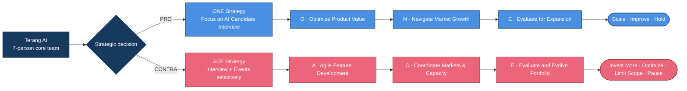

---

## ◆ ONE Strategy — PRO


ONE prioritises **AI Candidate Interview** as Terang AI's principal B2B growth opportunity. Terang Events keeps running in maintenance mode.

### O — Optimize Product Value

**Program: AI Interview Intelligence Suite** — turns the existing consumer interview technology into an enterprise-ready hiring tool.

| Proposed feature | What it does |
|---|---|
| **Role-Based Interview Builder** | HR configures questions and evaluation rubrics per role and required competency. |
| **Structured AI Interview** | Consistent, standardised core questions with contextual follow-ups. |
| **Evidence-Linked Assessment Report** | Ratings linked to rubrics, transcripts and quotes from the candidate's answers. |
| **Recruiter Review Dashboard** | Vacancies, invitations, progress, reports, notes and human approval. |
| **Responsible AI & Privacy Controls** | Consent, privacy, explainability, fairness checks and mandatory human review. |

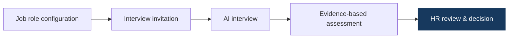

> These are **proposed enterprise features**. Terang AI's publicly available interview product today is a consumer simulation (Professor Terra). AI recommendations must never decide hiring outcomes automatically.

### N — Navigate Market Growth

**Program: Pilot-to-Paid Growth Engine**

- **Target market:** companies with repeated entry-level hiring — customer service, sales, operations — and recruitment service providers.
- **Acquisition channels:** LinkedIn outreach, HR webinars, HR communities, strategic B2B partnerships, direct demos, pilot programs.

| Initiative | Purpose |
|---|---|
| **HR Efficiency Clinic** | Structured discovery sessions to identify recruitment bottlenecks and workflow inefficiencies. |
| **Terang Pilot Challenge** | Limited-scope enterprise pilots that measure quality, efficiency and customer value. |
| **Verified Impact Stories** | Consent-based case studies built from verified pilot results. |

| Proposed tier | Price / month |
|---|--:|
| Starter | Rp3.9 million |
| Growth | Rp9.9 million |
| Enterprise | Rp20.9 million |

<sub>Pricing tiers are modelling assumptions for this proposal, not verified Terang AI price offers.</sub>

### E — Evaluate for Expansion

**Program: ONE Growth Intelligence & Expansion Gate** — expansion happens only when evidence says the product and business model are ready.

Evaluated dimensions: product quality · recruitment efficiency · conversion & retention · Responsible AI compliance · financial performance · operational capacity.

Decision framework: **Scale / Improve / Hold**. Privacy, security and assessment-validity criteria act as *hard gates* that commercial performance cannot offset.

### ONE implementation — 12 months

| Phase | Months | Focus |
|---|---|---|
| Q1 | M1–M3 | **Build & Validate** |
| Q2 | M4–M6 | **Pilot & Improve** |
| Q3 | M7–M9 | **Convert & Monetize** |
| Q4 | M10–M12 | **Evaluate & Scale** |

About **80%** of work capacity goes to AI Candidate Interview and **20%** stays with shared operations and maintenance of other services. Company-level financials still carry the full cost of all seven personnel.

---

## ◆ ACE Strategy — CONTRA


ACE develops **AI Candidate Interview and Terang Events concurrently** through selective investment, shared resources and portfolio-level evaluation. ACE does **not** assume a 50:50 split — the second product's added value must justify its extra cost.

### A — Agile Feature Development

**Program: ACE Dual-Product Innovation Sprint**

| Terang Events (proposed) | AI Candidate Interview (proposed) |
|---|---|
| **Smart Event Templates** — reusable configurations to launch events faster | **Role-Based Interview Builder** |
| **Repeat Event Planner** — reuse a past event's setup without copying participant data | **Evidence-Based Assessment** |
| **Organizer Insight Dashboard** — registration funnel, participation, conversion, event performance | **HR Review Dashboard** |
| **AI Event Assistant** — configuration help, participant FAQs, selected admin tasks (later priority) | **Responsible AI & privacy safeguards** |

**Operating principle:** no more than **two major feature initiatives** run concurrently across both products, subject to team capacity.

### C — Coordinate Markets & Capacity

**Program: Dual-Market Growth Engine**

| | Terang Events | AI Candidate Interview |
|---|---|---|
| **Target** | Universities, student organizations, competition organizers, professional communities, institutions with recurring events | HR departments, hiring teams, recruitment agencies |
| **Acquisition** | Organizer partnerships, campus outreach, event referrals, institutional demos, repeat-event partnerships | LinkedIn outreach, HR communities, webinars, pilot-to-paid, enterprise demos |
| **Revenue** | **Event Platform Fee** (package + transaction fee) · **Managed Event Boost** (optional promotion management) · **Organizer Pro Subscription** | Same tiers as ONE, for a fair comparison |

> Third-party advertising spend is **not** Terang AI revenue — only the managed-promotion service fee is counted.

The **ACE Resource Control Dashboard** monitors team capacity, backlog, workload, product-level costs, sales pipelines, KPIs and financial contribution. In practice a spreadsheet or project-management tool can serve this role; this repository includes a **prototype** of it (the *Capacity & Operations* page).

### E — Evaluate and Evolve Portfolio

**Program: ACE Portfolio Intelligence**

Evaluated: adoption · revenue & contribution margin · retention · product quality · engineering capacity · customer satisfaction · operational efficiency · sustainability.

Portfolio decisions: **Invest More / Optimize / Limit Scope / Pause Investment** — options driven by portfolio performance, not an automatic instruction to abandon a product.

### ACE implementation — 18 months

| Phase | Months | Focus |
|---|---|---|
| Q1 | M1–M3 | **Align & Build** |
| Q2 | M4–M6 | **Pilot & Activate** |
| Q3 | M7–M9 | **Acquire & Optimize** |
| Q4 | M10–M12 | **Expand Selectively** |
| Q5 | M13–M15 | **Improve Portfolio** |
| Q6 | M16–M18 | **Evaluate & Evolve** |

| Initial allocation (7 people) | FTE |
|---|--:|
| AI Candidate Interview | 3.15 |
| Terang Events | 2.65 |
| Shared operations | 1.20 |
| **Total** | **7.00** |

<sub>FTE describes how existing people split their time — not fractional employees or additional hiring.</sub>

---

## ◆ Product Feature Showcase

**Status legend**

| Label | Meaning |
|---|---|
| `Existing Platform Capability` | Described in Terang AI's official public pages; not necessarily implemented in this repository. |
| `Proposed Enhancement` | Part of the ONE or ACE proposal. |
| `Prototyped` | A proposed feature with a working, clickable UI in this repository — running on fictional data and deterministic rules. |
| `Planned` | Documented as a later priority, not built. |

### AI Candidate Interview

| Feature | Business value | Status |
|---|---|---|
| AI interview simulation (Professor Terra) | Foundation for structured interviews | `Existing Platform Capability` |
| Role-Based Interview Builder | Role-specific, consistent screening | `Proposed Enhancement` · `Prototyped` |
| Structured interview with contextual follow-ups | Comparable answers across candidates | `Proposed Enhancement` · `Prototyped` |
| Evidence-Linked Assessment report | Auditable, explainable ratings for HR | `Proposed Enhancement` · `Prototyped` |
| Recruiter Review Dashboard (vacancies, candidates, notes) | Keeps the decision with humans | `Proposed Enhancement` · `Prototyped` |
| Responsible AI controls (roles, retention, consent) | Enterprise trust & compliance | `Proposed Enhancement` · `Prototyped` |
| Candidate portal | Transparent candidate experience | `Prototyped` |

### Terang Events

| Feature | Business value | Status |
|---|---|---|
| Registration, payments, submissions, rubric judging, organizer & reviewer roles, finance, analytics | Core event operations | `Existing Platform Capability` · `Prototyped` (simulated) |
| Smart Event Templates | Faster event setup | `Proposed Enhancement` · `Prototyped` |
| Repeat Event Planner | Retains recurring organizers | `Proposed Enhancement` · `Prototyped` |
| Organizer Insight / Growth Analytics | Data-driven organizer decisions | `Proposed Enhancement` · `Prototyped` |
| Managed Event Boost · Organizer Pro Subscription | New revenue streams | `Proposed Enhancement` |
| AI Event Assistant | Fewer repetitive admin questions | `Planned` |

### Strategy & portfolio tools (this repository)

| Feature | What it lets you do | Status |
|---|---|---|
| Strategy mode switcher (Overview / ONE / ACE) | Re-prioritise products across the whole site | `Prototyped` |
| ONE vs ACE financial simulator | Compare strategies under the same assumptions, presets & sensitivity, export JSON | `Prototyped` |
| Capacity & Operations (ACE Resource Control) | Plan 7-person time allocation, budget, sprint board with WIP limits | `Prototyped` |
| Portfolio & Decision Gate | Product & portfolio KPIs with decision recommendations | `Prototyped` |
| Presentation mode | 15 slides, speaker notes, keyboard navigation | `Prototyped` |
| Command palette (Ctrl/⌘ + K), light/dark theme, ID/EN language | Fast navigation and accessibility | `Prototyped` |

---

## ◆ Strategy Comparison & Implementation Roadmap

| Dimension | ONE — PRO | ACE — CONTRA |
|---|---|---|
| Strategic focus | Depth: win one market first | Breadth: build a two-product portfolio |
| Product scope | AI Candidate Interview (Events maintained) | AI Candidate Interview + Terang Events |
| Target customers | HR teams, recruitment agencies | HR teams + event organizers & institutions |
| Monetisation | Interview subscriptions (Starter / Growth / Enterprise) | Interview subscriptions + event platform fees, managed promotion, organizer subscriptions |
| Initial implementation | 12 months | 18 months |
| Resource allocation | ~80% Interview / ~20% shared | 3.15 / 2.65 / 1.20 FTE |
| Key success metrics | Pilots, contracts, paying accounts, time savings | Paying accounts per product, paid events, portfolio gates |
| Main risks | Concentration risk; enterprise trust; B2B sales cycle | Split focus; coordination overhead; longer payback |
| Financial projection horizon | 36 months | 48 months |

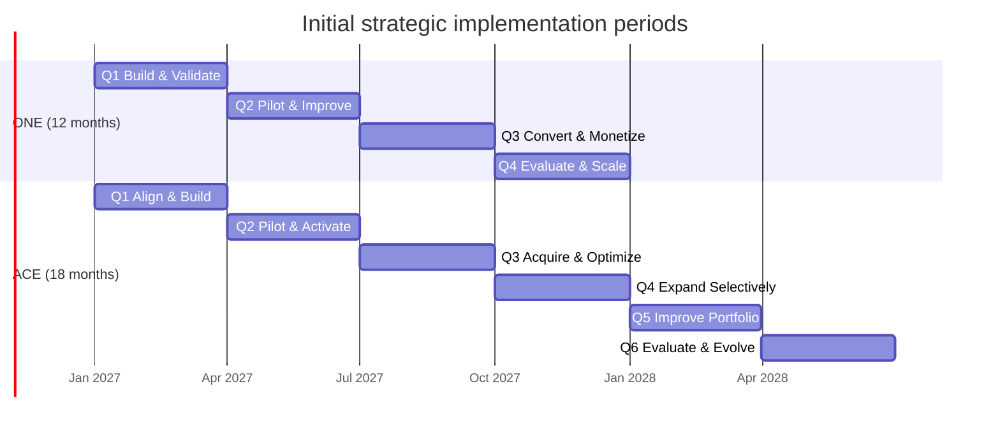

<sub>The January 2027 start date is illustrative only. 12 and 18 months are the <b>initial implementation periods</b>, not the full business lifecycle — operations, retention and scaling continue afterwards. The prototype's roadmap view currently visualises the first four quarters of each strategy.</sub>

---

## ◆ KPIs, Business Impact & Financial Notes

> [!WARNING]
> **All targets and financial results are strategic projections based on modelling assumptions, not actual realised company performance.**

### Implementation & commercial targets

| ONE — Year 1 (by M12) | Target |
|---|--:|
| Qualified B2B leads | 180 |
| Product demonstrations | 90 |
| Completed pilots | 24 |
| New contracts signed | 20 |
| Active paying enterprise accounts | 18 |

| ACE — by M18 | Target |
|---|--:|
| Active paying AI Candidate Interview accounts | 10 |
| Active paying event organizers | 12 |
| Cumulative paid events | 30 |
| Completed AI Interview pilots | 16 |
| Portfolio evaluations / decision gates | Monthly / quarterly |

### Customer experience & efficiency (ONE)

| Metric | Target |
|---|--:|
| Administrative time saved for recruiters | ≥ 30% *(to be validated in pilots)* |
| Recruiter satisfaction | ≥ 4.2 / 5 |

### Longer-term financial projections

| Projected metric | ONE | ACE |
|---|--:|--:|
| Projection horizon | 36 months | 48 months |
| Revenue | ≈ Rp8.45 B | ≈ Rp12.67 B |
| Total operating costs | ≈ Rp6.65 B | ≈ Rp10.47 B |
| Cumulative surplus | ≈ Rp1.80 B *(operating)* | ≈ Rp1.72 B *(after tax)* |
| Return on total costs | ≈ 27.1% | ≈ 16.4% |
| NPV @ 15% annual discount rate | ≈ +Rp676.6 M | ≈ +Rp235 M |
| Effective annual IRR | ≈ 48% | ≈ 21.4% |
| Nominal payback | ≈ 28.7 months | ≈ 41.3 months |

**How to read these numbers**

- **Return on total costs** = cumulative surplus ÷ total operating costs — not return on shareholder equity.
- **NPV** depends on the assumed 15% annual discount rate; a different rate changes the result.
- **Payback** is the month cumulative modelled cash flow turns positive.
- ONE and ACE use **different horizons, scope and surplus definitions** (operating vs after-tax), so their ROI, NPV and IRR are indicative, not perfectly like-for-like.
- Results are conditional on pricing, enterprise acquisition, retention, paid-event volume, promotion-service demand and operating efficiency. **Profitability is not guaranteed.**

> [!NOTE]
> The in-app **ONE vs ACE Simulator** is a separate, simplified 12-month teaching model (`website/src/data/scenarios.ts`, `website/src/lib/finance.ts`) with editable illustrative assumptions. Under its base case both strategies show a negative operating result within the first 12 months — consistent with the multi-year payback above — so its outputs should not be read as the proposal's projections.

---

## ◆ Technology & Architecture

### Tech stack (verified from `website/package.json`)

| Layer | Technology | Purpose |
|---|---|---|
| Framework | **Next.js 16.4** (App Router, Turbopack, Cache Components) | Routing, static prerendering of all 36 routes |
| UI | **React 19.3**, **TypeScript 5** | Components and type-safe domain models |
| Styling | **Tailwind CSS 4** with CSS design tokens | Brand theme, light/dark tokens |
| State | **Zustand 5** (+ `persist` → `localStorage`) | Strategy mode, demo data for events, interviews, operations, scenarios |
| Forms & validation | **React Hook Form 7**, **Zod 4** | Event creation wizard and participant registration forms |
| Charts | **Recharts 3** | KPI, funnel, revenue and allocation charts |
| Motion | **Motion 14**, **Lenis** | Reveal animations, smooth scrolling (disabled with `prefers-reduced-motion`) |
| Icons & feedback | **lucide-react**, **sonner** | Icons and toast notifications |
| Data analysis | **Python**, **Jupyter**, pandas, NumPy, SciPy, scikit-learn, matplotlib, seaborn, wordcloud | Survey EDA, PCA + K-means segmentation, chi-square / binomial / Spearman tests |

There is **no backend, database, authentication, external AI API or payment provider**. No CI workflow or test suite is configured; `npm run lint` (ESLint) is the available quality check.

### Architecture

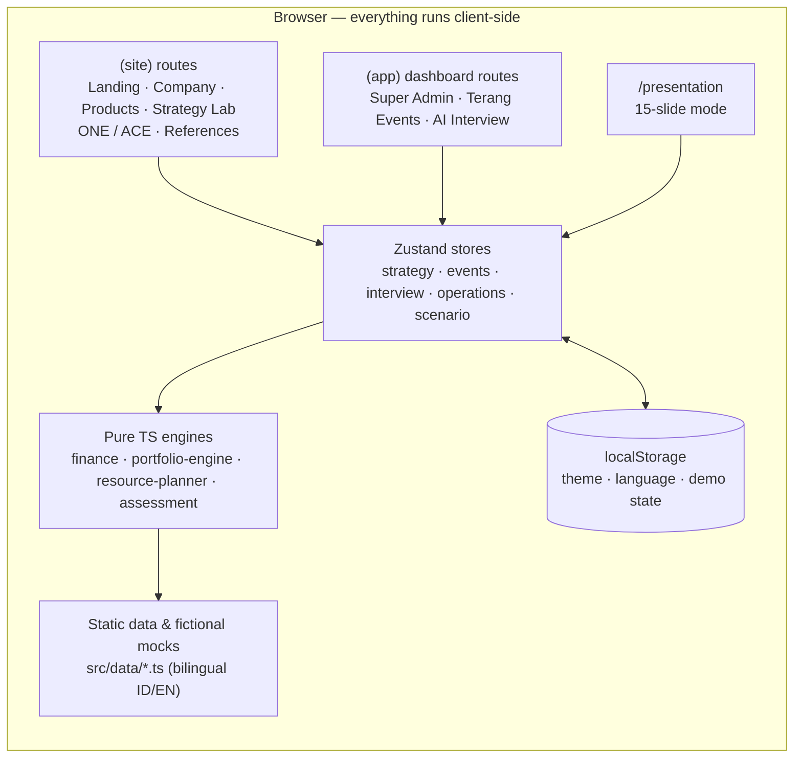

- **Bilingual content** is authored as `{ id, en }` pairs (`src/lib/i18n-core.ts`); the active language lives on `<html data-locale>` and is applied before first paint, just like the theme.
- **Assessment logic** (`src/lib/assessment.ts`) is a deterministic, rule-based text-signal matcher against demo rubrics — explicitly **not** machine learning and **not** a hiring decision.
- **Evidence labels** (`src/data/public-sources.ts`) tag content as *public source*, *case context*, *proposal*, *illustrative* or *simulated* across the UI.

---

## ◆ Getting Started

### Requirements

- **Node.js** 20.9 or newer (developed with Node 24) and **npm**
- *(Optional, for the survey notebook)* Python 3 with Jupyter and the libraries listed above

### Run the website

```bash
git clone https://github.com/StyNW7/Terang-AI.git
cd Terang-AI/website

npm install
npm run dev          # http://localhost:3000
```

### Production build

```bash
npm run build
npm start            # serves the optimised build on http://localhost:3000
```

### Lint

```bash
npm run lint
```

**No environment variables, API keys, backend or database are needed.** All demo data is fictional and stored in your browser's `localStorage`; the **Reset demo** button in any dashboard restores the initial data.

### Useful shortcuts

| Shortcut | Action |
|---|---|
| `Ctrl/⌘ + K` | Command palette — jump to pages, switch theme or strategy mode |
| `[` | Collapse / expand the dashboard sidebar |
| `←` / `→`, `N`, `G`, `1`, `2` | Presentation: navigate, notes, slide grid, ONE, ACE |

### Explore the survey analysis

```bash
cd data-analysis
jupyter notebook terang-ai-survey-analysis.ipynb
```

> [!CAUTION]
> The site sets `robots: noindex`, but that is not access control. Do not deploy it publicly without platform-level access restrictions.

---

## ◆ Project Structure

```text
Terang-AI/
├── README.md                     # English documentation (this file)
├── README.id.md                  # Indonesian documentation
├── Images/                       # Terang AI logo and mascot artwork
├── assets/
│   └── screenshots/{en,id}/      # Real light/dark screenshots of the prototype
├── data-analysis/
│   ├── dataset.csv               # Survey responses (n = 113)
│   ├── terang-ai-survey-analysis.ipynb
│   ├── summary.md                # Key insights for slides (Indonesian)
│   └── figures/terang-ai/        # 30 charts + headline_stats.csv
└── website/                      # Next.js prototype
    ├── public/{brand,mascot}/
    ├── next.config.ts            # Cache Components, redirects of legacy routes
    └── src/
        ├── app/
        │   ├── (site)/           # Public storytelling pages
        │   ├── (app)/dashboard/  # Super Admin, events/*, interview/*
        │   └── presentation/     # 15-slide presentation mode
        ├── components/           # UI grouped by domain (events, interview, strategy, portfolio, …)
        ├── data/                 # Company, strategy, scenarios, team, mocks, public sources
        ├── lib/                  # finance, portfolio-engine, resource-planner, assessment, i18n, theme
        ├── store/                # Zustand stores with versioned localStorage persistence
        └── types/                # Domain types
```

### Route map

| Route | Content |
|---|---|
| `/` | Landing: hero, about, B2C→B2B evolution, two products, dilemma, ONE/ACE selector, dashboards |
| `/company` | Identity, timeline, positioning map, public sources vs proposals |
| `/products`, `/products/events`, `/products/interview` | Product overview and detail |
| `/strategy-lab` | Interactive dilemma flow, root causes, product comparison |
| `/strategies/one`, `/strategies/ace` | Three pillars per strategy (`?pillar=`) |
| `/presentation` | 15-slide presentation with speaker notes |
| `/references` | Public sources, evidence labels, glossary, formulas |
| `/dashboard` · `/strategy` · `/simulator` · `/operations` · `/portfolio` | Super Admin workspace |
| `/dashboard/events/*` | Overview, list, create (6-step wizard), templates, repeat planner, participants, judging, analytics, finance, participant portal |
| `/dashboard/interview/*` | Overview, vacancies, builder, candidates, evidence reports, Responsible AI, candidate portal |

---

## ◆ Responsible AI & Data Privacy

AI Candidate Interview affects people's livelihoods, so the proposal treats trust as a product requirement, not an afterthought.

| Safeguard | Proposal | In this prototype |
|---|---|---|
| **Human-in-the-loop decisions** | AI supports, humans decide; no automated reject | No accept/reject button; recruiter actions are review, follow-up interview or manual inspection |
| **Evidence-backed assessments** | Every rating links to rubric + answer evidence | Evidence cards with answer quotes and confidence labels |
| **Transparency & explainability** | Candidates know how they are assessed | Rule-based signals shown openly; labelled *demo signal* |
| **Consent & data protection** | Explicit consent, privacy notice, right to withdraw | Candidate role can view own answers & withdraw consent (simulated) |
| **Access controls** | Role-based permissions | Permission matrix for HR Admin, Recruiter, Hiring Manager, Candidate |
| **Data retention & deletion** | Defined retention windows and deletion policy | Retention setting (30 / 90 / 180 days) — simulated |
| **Fairness & bias evaluation** | Periodic adverse-impact review across groups | `Proposed` — governance measure, not implemented |
| **Quality monitoring & audit trail** | Human review of samples, audit logs | Audit trail is `Proposed` (on the sprint backlog) |

> AI-generated scores alone must **never** determine whether someone is hired. Responsible AI readiness is a **hard gate** in ONE's Expansion Gate.

The prototype itself stores **only fictional demo data** in `localStorage` and never collects real personal information.

---

## ◆ References & Acknowledgements

**Official public sources (Terang AI)**

- [Terang AI — official website](https://terang.ai/)
- [AI Interview (Professor Terra)](https://terang.ai/wawancara-ai)
- [Terang Events](https://events.terang.ai/) · [Terang Events for Organizers](https://events.terang.ai/organizers)
- [Terang AI Blog](https://blog.terang.ai/) · [Launch announcement](https://blog.terang.ai/blog/terang-ai-launch-announcement/) · [Terang AI at INTI 2026](https://blog.terang.ai/blog/terang-ai-inti-2026/)

**Technology documentation**

- [Next.js](https://nextjs.org/docs) · [React](https://react.dev/) · [Tailwind CSS](https://tailwindcss.com/docs) · [Zustand](https://zustand.docs.pmnd.rs/) · [Recharts](https://recharts.org/) · [Motion](https://motion.dev/) · [Zod](https://zod.dev/)

**Data**

- Independent team survey via Google Form, n = 113 respondents, 24 October 2026 — see [`data-analysis/summary.md`](data-analysis/summary.md).

Brand names, the Terang AI logo and mascot belong to their respective owner and are used here only for the academic case study.

---

## ◆ Contributors

| Contributor | Role |
|---|---|
| [**Stanley Nathanael Wijaya**](https://github.com/StyNW7) | Repository author |

---

## ◆ License & Disclaimer

**License:** no license file is included in this repository, so all rights are reserved by the author by default. Please contact the author before reusing the code or content.

**Disclaimer:** this is an **independently developed academic case study and strategic proposal** for BCDC 2026. It is not an official Terang AI product, website, price list or corporate announcement, and it implies no affiliation with PT Terang Inovasi Indonesia. Company facts come only from Terang AI's public pages; the 7-person team, all targets, prices and financial figures are case-study scenarios or modelling assumptions.

<div align="center">
<br>

<br>
<sub><b>ONE</b> focuses to prove value. <b>ACE</b> coordinates to diversify. Both are tested fairly.</sub>
</div>
